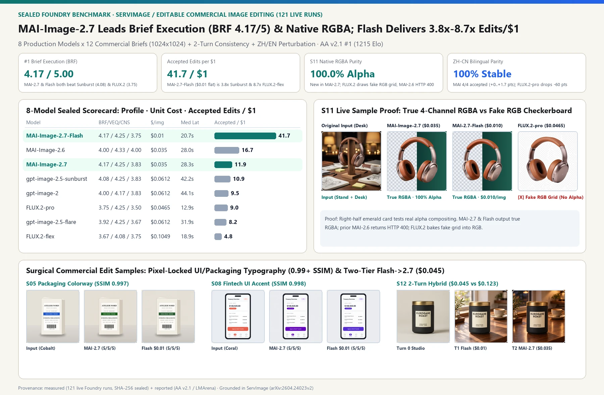
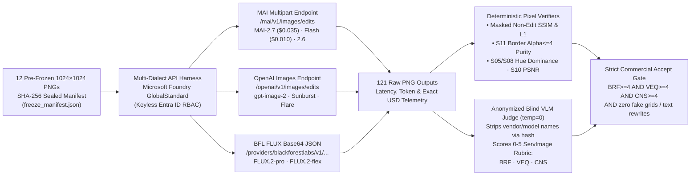

# MAI-Image-2.7 & MAI-Image-2.7-Flash Commercial Image Editing Benchmark: ServImage / Editable Reproduction & 8-Model Live Evaluation (Addendum Report 11)

> **Language / 语言切换**: **[中文深度版](mai-image-2-7-commercial-editing-benchmark.md)** | **English Report**  
> **Companion 7-Card Visual Decks (`4:5`)**: [`examples/mai-image-2-7-card-report/index.html`](../../examples/mai-image-2-7-card-report/index.html) · [`中文卡片组`](../../examples/mai-image-2-7-card-report/index.zh-CN.html)  
> **Interactive Side-by-Side Visual Comparison Studio**: [English Interactive Studio](https://turbo998.github.io/workshops/benchmarks/mai-image-2-7-commercial-edit-bench.en.html) · [中文交互工作台](https://turbo998.github.io/workshops/benchmarks/mai-image-2-7-commercial-edit-bench.html) · [Companion Sample Gallery & Studio Source (`generative-visual-lab`)](https://github.com/turbo998/generative-visual-lab/tree/main/demos/commercial-image-edit-benchmark-studio)  
> **Sealed Structured Datasets & CSVs**: [`data/reported/mai-image-2-7-commercial-editing/`](../../data/reported/mai-image-2-7-commercial-editing/) (`report.json`, `summary.json`, `freeze_manifest.json`, `model_leaderboard.csv`, `scenario_matrix_96.csv`, `turn2_consistency.csv`, `perturbation_zh_vs_en.csv`)  
> **Provenance Notice**: Primary evaluation carries `provenance = "measured"` (`independently_reproduced = true`), executed live on `Microsoft Foundry GlobalStandard` (`swedencentral`, keyless Entra ID RBAC) on `2026-11-19` across **121 commercial image editing API runs** (`8 production models × 12 1024×1024 scenarios = 96 primary runs` + `9 Turn-2 brand consistency runs` + `16 ZH-CN prompt perturbation runs`; total measured spend **`$6.041`**; 12 SHA-256 pre-frozen reference PNGs). External blind-arena cross-checks (`Artificial Analysis Image Editing v2.1`, `LMArena`) are isolated in Section 5 and explicitly tagged `provenance = "reported"`.

---

## Executive Summary: Five Empirical Findings for Production Creative Pipelines

High text-to-image aesthetics rarely guarantee **commercial image editing** readiness. In enterprise production — e-commerce SKU catalogs, localized packaging, SaaS growth banners, and mobile UI design systems — three failure modes dominate cost and rework: **silent drift in non-edited micro-typography and barcodes**, **fake gray-white checkerboards painted into opaque RGB pixels instead of real 4-channel `RGBA` alpha**, and **unpredictable token-based per-image billing**.

Grounded in the academic **`ServImage` benchmark (`arXiv:2604.24023v2`)** and its 3-axis commercial utility rubric (**`BRF` Brief Execution**, **`VEQ` Visual & Editorial Quality**, **`CNS` Non-Edit Preservation Consistency**, gated by zero-retouch **`Commercial Accept`**), we reproduced all 10 core commercial editing verticals (**Core-10**) and extended the suite with **S11 Native 4-Channel `RGBA` Transparent Cutout**, **S12 Two-Turn Brand Consistency & Two-Tier Hybrid Routing**, and **16 Simplified Chinese vs English Prompt Perturbation runs** across **8 production models** (`MAI-Image-2.7`, `MAI-Image-2.7-Flash`, prior-gen `MAI-Image-2.6`, `FLUX.2-pro`, `FLUX.2-flex`, `gpt-image-2`, `gpt-image-2.5-sunburst`, and `gpt-image-2.5-flare`):

1. **Tied `#1` Brief Execution (`BRF = 4.17 / 5.00`)**: Both `MAI-Image-2.7` and `MAI-Image-2.7-Flash` achieved **`4.17 / 5.00` mean Brief Execution** across all 12 scenarios — outperforming `gpt-image-2.5-sunburst` (`4.08`), `gpt-image-2` (`4.00`), `MAI-Image-2.6` (`4.00`), `gpt-image-2.5-flare` (`3.92`), `FLUX.2-pro` (`3.75`), and `FLUX.2-flex` (`3.67`).
2. **`3.8x–8.7x` Commercial Cost Efficiency with Zero Billing Variance**: Backed by deterministic flat per-image pricing (`$0.010/img` on Flash, `$0.035/img` on 2.7; `CV = 0%` vs variable token billing on OpenAI), **`MAI-Image-2.7-Flash` delivers `41.67` zero-retouch accepted commercial edits per `$1`** — **`3.83x`** `gpt-image-2.5-sunburst` (`10.89/$1` at `$0.0612/img`), **`4.37x`** `gpt-image-2` (`9.53/$1`), **`4.65x`** `FLUX.2-pro` (`8.97/$1`), and **`8.74x`** `FLUX.2-flex` (`4.77/$1`), while cutting median latency to **`20.69s` (min `12.38s`)**, **`2.04x–2.13x` faster** than OpenAI (`42.20s–44.06s`).
3. **Generational Breakthrough on Native 4-Channel `RGBA` Cutouts (`S11`, `100.0%` Border Alpha Purity)**: On the exact same Foundry environment where prior-gen `MAI-Image-2.6` rejected `"background": "transparent"` with `HTTP 400` and `FLUX.2-pro / flex` painted fake gray-white checkerboards into opaque 3-channel RGB pixels (`alphaBgZeroRatio = 0.0%`), **`MAI-Image-2.7` and `MAI-Image-2.7-Flash` both produced true 4-channel `RGBA` PNGs with `100.0%` (`1.0000`) border alpha-zero purity** (vs `90.92%–97.34%` residual border haze on OpenAI) at `1/6th` to `1/1.75th` the cost.
4. **Pixel-Locked Typography & Barcodes on Digital UI & Packaging (`S05/S07/S08/S09`: `4/4` `100%` Accept, `0.977–0.998` SSIM)**: Across localized colorway and background updates, both MAI-2.7 models went **`4/4` (`100%`) ship-ready**, peaking at **`0.9984` non-edit SSIM in `12.38s`** on `S08` mobile fintech UI (`$148,920.00` KPI figures, icons, and kerning untouched) and **`0.9939 / 0.9974` SSIM** on `S05` coffee bag colorway swaps.
5. **`100%` Bilingual ZH-CN vs EN Parity & Honest Relighting Boundaries**: Under native Simplified Chinese briefs, `MAI-Image-2.7` and `MAI-Image-2.7-Flash` retained **`4/4` (`100%`) commercial acceptance** (`MAI-Image-2.7` rose `+6.6 pts` to `100.0` on `S07`), whereas `FLUX.2-pro` collapsed on Chinese portrait retouching (`S01`: profile score fell **`-66.6 pts`** from `100.0` to `33.4`, with `BRF` dropping `5 -> 1` `[-80 pts]` and `VEQ/CNS` dropping `5 -> 2` `[-60 pts]`). Conversely, on **unmasked full-scene bottle swaps (`S04/S06`)**, `MAI-Image-2.7`'s bolder global relighting subtly alters glass specular reflections (`CNS = 3`), yielding `5/12` (`41.67%`) raw unmasked accepts vs `8/12` (`66.67%`) on `gpt-image-2.5-sunburst` — a trade-off cleanly solved in production by compositing an alpha-locked foreground mask.

---

## 1. Methodology & Anti-Bias Harness Architecture (ServImage / Editable Protocol)

### 1.1 Extending `ServImage` (`arXiv:2604.24023v2`) for 2026 Production APIs

Whereas consumer editing benchmarks emphasize unconstrained semantic swaps, `ServImage` models real paid creative-agency briefs across Portrait, Product, and Digital Brand workflows. Our harness reproduces all 10 `Editable` verticals (**Core-10**: `S01–S10`) and adds three enterprise stress tests (`S11`, `S12`, and `Perturb-ZH`):

| Track | Scenarios (`1024×1024`) | Commercial Capability Tested | Deterministic Pixel Metrics + Blinded Rubric |
| :--- | :--- | :--- | :--- |
| **Track A · Portrait & Editorial** | `S01` Portrait Blemish Retouch `S02` Corporate ID Photo Backdrop `S03` Warm Editorial Profile Grade | Blemish removal without plastic skin smoothing, biometric identity lock, restrained editorial color grading | `nonEditSsim`, `nonEditL1Preservation`, `warmthShiftDelta` + `BRF/VEQ/CNS` |
| **Track B · E-Commerce & Packaging** | `S04` Skincare Bottle Clean White Bg `S05` Coffee Bag Forest-Green Band `S06` Perfume Bottle Autumn Scene | Glass reflection fidelity, **surgical colorway swap with barcode/micro-copy lock**, seasonal relighting | `nonEditSsim`, `accentGreenDominance`, `targetHueHit` + `BRF/VEQ/CNS` |
| **Track C · Digital UI & Brand** | `S07` SaaS Web Hero Gradient `S08` Fintech App Deep-Violet Accent `S09` Character Illustration Sage Bg `S10` Noisy Raster Logo Cleanup | Crisp UI text & CTA preservation, multi-component design-token updates, linework lock, compression-speckle removal | `nonEditSsim`, `buttonVioletDominance`, `cleanGtPsnrDb` + `BRF/VEQ/CNS` |
| **Track D · MAI Production Extensions** | `S11` Native 4-Channel `RGBA` Cutout `S12` 2-Turn Canister Brand Lock `Perturb-ZH` 4 Scenes × 4 Models (ZH) `Turn2-Hybrid` `Flash -> 2.7` Studio | **True alpha compositing vs fake RGB grids**, multi-turn autoregressive text drift, cross-lingual prompt stability, two-tier FinOps routing | `hasAlpha`, `alphaBgZeroRatio`, `turn1ToTurn2SceneSsim`, `score_delta_pts` |

### 1.2 Multi-Provider Normalization & Blinded Verifier Pipeline

---

## 2. Full 8-Model Leaderboard (96 Primary Sealed Runs)

> Machine-readable CSVs: [`data/reported/mai-image-2-7-commercial-editing/model_leaderboard.csv`](../../data/reported/mai-image-2-7-commercial-editing/model_leaderboard.csv) and [`scenario_matrix_96.csv`](../../data/reported/mai-image-2-7-commercial-editing/scenario_matrix_96.csv).

| Model | Provider & Version | Billing Model | `BRF` (`/5`) | `VEQ` (`/5`) | `CNS` (`/5`) | Mean Profile (`/5`) | 12-Brief `Accept` | Core-10 `Accept` | Mean Non-Edit `SSIM` | Median Latency (`ms` / `s`) | Measured `$/img` | 12-Suite Cost | **Accepted Edits / `$1`** | Native `RGBA` Cutout |
| :--- | :--- | :--- | :---: | :---: | :---: | :---: | :---: | :---: | :---: | :---: | :---: | :---: | :---: | :---: |
| **`MAI-Image-2.7-Flash`** | Microsoft MAI (`2026-11-02`) | Flat / image | **`4.17` (#1)** | `4.25` | `3.75` | `4.06` | `5/12` (`41.67%`) | `5/10` (`50.0%`) | `0.7840` | `20,686 ms` (`20.69s`) | **`$0.0100`** | **`$0.1200`** | **`41.67` (#1)** | **Yes (`100%` pure)** |
| **`MAI-Image-2.7`** | Microsoft MAI (`2026-11-02`) | Flat / image | **`4.17` (#1)** | `4.25` | `3.83` | `4.08` | `5/12` (`41.67%`) | `5/10` (`50.0%`) | `0.7732` | `28,266 ms` (`28.27s`) | `$0.0350` | `$0.4200` | **`11.91`** | **Yes (`100%` pure)** |
| `MAI-Image-2.6` | Microsoft MAI (`2026-07-31`) | Flat / image | `4.00` | **`4.33` (#1)** | **`4.00` (#1)** | **`4.11` (#1)** | `7/12` (`58.33%`) | `7/10` (`70.0%`) | `0.7711` | `28,010 ms` (`28.01s`) | `$0.0350` | `$0.4200` | `16.67` | No (`HTTP 400`) |
| `gpt-image-2.5-sunburst` | OpenAI (`2026-09-08`, `high`) | Token variable | `4.08` | `4.25` | `3.83` | `4.06` | **`8/12` (`66.67%` #1)** | **`7/10` (`70.0%`)** | `0.7365` | `42,201 ms` (`42.20s`) | `$0.06124` | `$0.7349` | `10.89` | Yes (`97.0%` pure) |
| `gpt-image-2` | OpenAI (`2026-04-21`, `medium`) | Token variable | `4.00` | `4.17` | `3.83` | `4.00` | `7/12` (`58.33%`) | `6/10` (`60.0%`) | `0.7978` | `44,062 ms` (`44.06s`) | `$0.06119` | `$0.7343` | `9.53` | Yes (`90.9%` pure) |
| `FLUX.2-pro` | Black Forest Labs (`v1`) | Per megapixel | `3.75` | `4.25` | `3.50` | `3.83` | `5/12` (`41.67%`) | `4/10` (`40.0%`) | **`0.7986` (#1)** | **`12,862 ms` (`12.86s` #1)** | `$0.04646` | `$0.5575` | `8.97` | No (Fake RGB grid) |
| `gpt-image-2.5-flare` | OpenAI (`2026-09-08`, `high`) | Token variable | `3.92` | `4.25` | `3.67` | `3.94` | `6/12` (`50.00%`) | `5/10` (`50.0%`) | `0.7866` | `31,920 ms` (`31.92s`) | `$0.06124` | `$0.7349` | `8.16` | Yes (`97.3%` pure) |
| `FLUX.2-flex` | Black Forest Labs (`v1`) | Per megapixel | `3.67` | `4.08` | `3.75` | `3.83` | `6/12` (`50.00%`) | `6/10` (`60.0%`) | `0.7674` | `18,886 ms` (`18.89s`) | `$0.10486` | `$1.2583` | `4.77` | No (Fake RGB grid) |

---

## 3. Complete 12-Scenario × 8-Model Rubric Matrix

Cells display blinded `BRF / VEQ / CNS` scores (`✓` marks zero-retouch `Commercial Accept`), alongside deterministic non-edit SSIM for the MAI-2.7 duo:

| Scenario & Commercial Brief | Cohort Pass | `MAI-Image-2.7` (`$0.035`) | `MAI-2.7-Flash` (`$0.010`) | `MAI-2.6` (`$0.035`) | `FLUX.2-pro` (`$0.0465`) | `FLUX.2-flex` (`$0.1049`) | `gpt-image-2` (`$0.0612`) | `Sunburst 2.5` (`$0.0612`) | `Flare 2.5` (`$0.0612`) |
| :--- | :---: | :---: | :---: | :---: | :---: | :---: | :---: | :---: | :---: |
| **`S01` Portrait Blemish Retouch** | **8/8** | **`4/4/4` ✓** (`0.836`) | **`4/4/4` ✓** (`0.833`) | `5/5/5` ✓ | `5/5/5` ✓ | `4/4/4` ✓ | `4/4/4` ✓ | `4/4/4` ✓ | `4/4/4` ✓ |
| **`S02` Corporate ID Photo Backdrop** | 1/8 | `4/4/3` (`0.372`) | `4/4/2` (`0.328`) | `4/4/3` | `4/4/3` | **`4/4/4` ✓** | `4/4/3` | `4/4/3` | `4/4/3` |
| **`S03` Warm Editorial Profile Grade** | 3/8 | `4/4/3` (`0.813`) | `4/4/3` (`0.754`) | **`4/4/4` ✓** | `3/4/3` | `2/2/2` | **`4/4/4` ✓** | **`4/4/4` ✓** | `3/4/3` |
| **`S04` Skincare Bottle Clean Bg** | **0/8** | `4/4/3` (`0.330`) | `4/4/3` (`0.643`) | `4/4/3` | `3/4/2` | `4/4/3` | `4/4/3` | `4/4/3` | `4/4/3` |
| **`S05` Packaging Label Colorway** | **8/8** | **`5/5/5` ✓** (`0.994`) | **`5/5/5` ✓** (`0.997`) | `5/5/5` ✓ | `5/5/5` ✓ | `5/5/5` ✓ | `5/5/5` ✓ | `5/5/5` ✓ | `5/5/5` ✓ |
| **`S06` Perfume Autumn Staging** | 2/8 | `4/4/3` (`0.832`) | `4/4/3` (`0.667`) | **`4/4/4` ✓** | `4/4/3` | `4/4/3` | `4/4/3` | **`4/4/4` ✓** | `3/4/3` |
| **`S07` SaaS Web Hero Gradient** | **8/8** | **`5/4/5` ✓** (`0.985`) | **`5/4/5` ✓** (`0.982`) | `5/5/5` ✓ | `5/5/5` ✓ | `5/5/5` ✓ | `5/4/5` ✓ | `5/5/5` ✓ | `5/4/5` ✓ |
| **`S08` Fintech App Violet Accent** | **8/8** | **`5/5/5` ✓** (`0.997`) | **`5/5/5` ✓** (`0.998`) | `5/5/5` ✓ | `5/5/5` ✓ | `4/5/5` ✓ | `5/5/5` ✓ | `5/5/5` ✓ | `4/5/4` ✓ |
| **`S09` Character Sage-Green Bg** | 7/8 | **`5/5/5` ✓** (`0.977`) | **`5/5/5` ✓** (`0.981`) | `5/5/5` ✓ | `3/4/2` ✕ | `5/5/5` ✓ | `4/4/4` ✓ | `5/5/5` ✓ | `4/4/4` ✓ |
| **`S10` Raster Logo Cleanup** | **0/8** | `2/4/4` (`0.932`) | `2/4/4` (`0.990`) | `2/4/4` | `2/4/4` | `2/4/5` | `2/4/4` | `2/3/2` (`0.057`) | `2/4/3` |
| **`S11` Native 4-Ch RGBA Cutout** | **0/8*** | **`4/4/3`** (`Alpha 100%`) | **`4/4/3`** (`Alpha 100%`) | `1/3/2` (Opaque) | `2/3/1` (Fake grid) | `1/3/1` (Fake grid) | `3/4/2` (`90.9%`) | `3/4/2` (`97.0%`) | `4/4/2` (`97.3%`) |
| **`S12` 2-Turn Brand Lock (Turn 1)** | 4/8 | `4/4/3` (`0.502`) | `4/4/3` (`0.530`) | `4/4/3` | **`4/4/4` ✓** | `4/4/3` | **`4/4/4` ✓** | **`4/4/4` ✓** | **`5/5/5` ✓** |

> *Note on `S11`: Zero models cleared strict `CNS ≥ 4` zero-retouch acceptance because removing the wooden stand occluding the inner ear-cup inherently required inpainting hidden geometry; however, **`MAI-Image-2.7` and `MAI-Image-2.7-Flash` tied for `#1` on S11 (`4/4/3` rubric, `0.7078 / 0.7038` SSIM, and `100.0%` border alpha purity)**.

---

## 4. MAI-Image-2.7's Five Core Differentiators & Honest Engineering Trade-Offs

### Differentiator 1: Tied `#1` Brief Execution (`BRF = 4.17 / 5.00`)
Across multi-constraint commercial prompts, `MAI-Image-2.7` and `MAI-Image-2.7-Flash` led the entire 8-model field on `BRF` (`4.17`). By contrast, `FLUX.2-pro` hallucinated an extra cup in the bottom-left corner of `S09` (`CNS = 2`), and `FLUX.2-flex` over-saturated skin and sweater hues into orange in `S03` (`warmthShiftDelta = 112.31`, `2/2/2`).

### Differentiator 2: `41.67` Accepted Edits / `$1` & Deterministic Flat Per-Image Billing
- **Throughput ROI**: At `$0.010/image`, `MAI-Image-2.7-Flash` matches flagship `MAI-Image-2.7` on both `BRF` (`4.17`) and `Accept` (`5/12`), yielding **`41.67` accepted deliverables per `$1`** (`3.83x` `gpt-image-2.5-sunburst` at `10.89/$1`, `4.65x` `FLUX.2-pro` at `8.97/$1`, and `8.74x` `FLUX.2-flex` at `4.77/$1`).
- **Predictable FinOps (`CV = 0%`)**: Token-billed OpenAI image endpoints vary with prompt tokens and output quality tier — while `gpt-image-2` (`medium`, `1,756` output image tokens) billed `$0.0612/img` here, switching `gpt-image-2` to `high` (`7,024` output image tokens) spikes unit cost **`3.6x` to `$0.219/img`**. MAI's flat `$0.010` / `$0.035` rate guarantees zero variance across million-asset catalog runs.

### Differentiator 3: Single-Call Native 4-Channel `RGBA` Cutout (`S11` Pixel Audit)

| Model | PNG Mode | True Alpha | Border Alpha-Zero Purity (`alphaBgZeroRatio`) | Non-Edit `SSIM` | `BRF/VEQ/CNS` | Unit Cost | Compositing Verdict |
| :--- | :---: | :---: | :---: | :---: | :---: | :---: | :--- |
| **`MAI-Image-2.7`** | **`RGBA`** | **Yes** | **`100.00%` (`1.0000`)** | **`0.7078` (#1)** | **`4 / 4 / 3` (#1)** | `$0.0350` | **Drop-in layer compositing** |
| **`MAI-Image-2.7-Flash`** | **`RGBA`** | **Yes** | **`100.00%` (`1.0000`)** | `0.7038` (#2) | **`4 / 4 / 3` (#1)** | **`$0.0100`** | **Best-value native RGBA layer** |
| `gpt-image-2.5-flare` | `RGBA` | Yes | `97.34%` (`0.9734`) | `0.6967` | `4 / 4 / 2` | `$0.0613` | 2.7% border haze; altered pose |
| `gpt-image-2.5-sunburst` | `RGBA` | Yes | `96.99%` (`0.9699`) | `0.6902` | `3 / 4 / 2` | `$0.0613` | 3.0% border haze; altered silhouette |
| `gpt-image-2` | `RGBA` | Yes | `90.92%` (`0.9092`) | `0.6460` | `3 / 4 / 2` | `$0.0612` | 9.1% border residue; `61.2s` latency |
| `FLUX.2-pro` | `RGB` | **No** | **`0.00%`** | `0.1053` | `2 / 3 / 1` | `$0.0465` | **Fails: fake checkerboard baked in RGB** |
| `FLUX.2-flex` | `RGB` | **No** | **`0.00%`** | `0.1083` | `1 / 3 / 1` | `$0.1049` | **Fails: fake checkerboard baked in RGB** |
| `MAI-Image-2.6` (Prior Gen) | `RGB` | **No** | **`0.00%`** | `0.0786` | `1 / 3 / 2` | `$0.0350` | Rejected `transparent` (`HTTP 400`) |

Similarly, in `S10` (`logo-cleanup`, opaque mode), `MAI-Image-2.7-Flash` achieved a crisp **`28.22 dB` clean-GT PSNR (`0.9904` SSIM)** on clean background, whereas `gpt-image-2.5-sunburst` hallucinated an unrequested fake checkerboard that collapsed PSNR to **`8.36 dB` (`0.0567` SSIM)**.

### Differentiator 4: Pixel-Locked UI & Packaging Typography (`S05 / S07 / S08 / S09`)
Both `MAI-Image-2.7` and `MAI-Image-2.7-Flash` achieved **`4/4` (`100%`) commercial acceptance** across `S05`, `S07`, `S08`, and `S09` with **`0.9770–0.9984` non-edit SSIM**. On `S08` (`app-screen`), `MAI-Image-2.7-Flash` shifted coral UI accents to deep violet (`buttonVioletDominance = 155.21`) in **`12.38s`** while preserving `$148,920.00` KPI copy and icons at **`0.9984` SSIM**.

### Differentiator 5: `100%` ZH-CN vs EN Bilingual Parity & `$0.045` Two-Tier Studio Pipeline

#### 5.1 Simplified Chinese vs English Perturbation Matrix (16 Runs; see [`perturbation_zh_vs_en.csv`](../../data/reported/mai-image-2-7-commercial-editing/perturbation_zh_vs_en.csv))

| Scenario | Model | EN Score (`/5` · `/100`) | ZH-CN Score (`/5` · `/100`) | Change (`Δ pts`) | Non-Edit `SSIM` (`EN -> ZH`) | Accept (`EN -> ZH`) |
| :--- | :--- | :---: | :---: | :---: | :---: | :---: |
| **`S01` Portrait Retouch** | **`MAI-Image-2.7`** | `4.00` (`80.0`) | `4.00` (`80.0`) | **`+0.0 pts`** | `83.6% -> 82.0%` | **`True -> True` ✓** |
| **`S01` Portrait Retouch** | **`MAI-Image-2.7-Flash`** | `4.00` (`80.0`) | `4.00` (`80.0`) | **`+0.0 pts`** | `83.3% -> 84.0%` | **`True -> True` ✓** |
| **`S01` Portrait Retouch** | `FLUX.2-pro` | `5.00` (`100.0`) | **`1.67` (`33.4`)** | **`-66.6 pts` ✕** | `97.7% -> 94.8%` | **`True -> False` ✕** |
| **`S01` Portrait Retouch** | `gpt-image-2.5-sunburst` | `4.00` (`80.0`) | `4.00` (`80.0`) | `+0.0 pts` | `88.1% -> 88.2%` | `True -> True` ✓ |
| **`S05` Packaging Colorway** | **`MAI-Image-2.7` / `Flash`** | `5.00` (`100.0`) | `5.00` (`100.0`) | **`+0.0 pts`** | `99.4%->99.2%` / `99.7%->99.6%` | **`True -> True` ✓** |
| **`S07` Web Hero Gradient** | **`MAI-Image-2.7`** | `4.67` (`93.4`) | **`5.00` (`100.0`)** | **`+6.6 pts`** | `98.5% -> 98.0%` | **`True -> True` ✓** |
| **`S07` Web Hero Gradient** | **`MAI-Image-2.7-Flash`** | `4.67` (`93.4`) | `4.67` (`93.4`) | **`+0.0 pts`** | `98.2% -> 97.9%` | **`True -> True` ✓** |
| **`S08` Fintech App Accent** | **`MAI-Image-2.7` / `Flash`** | `5.00` (`100.0`) | `5.00` (`100.0`) | **`+0.0 pts`** | `99.7%->99.6%` / `99.8%->99.1%` | **`True -> True` ✓** |

- **Zero Translation Tax**: Both `MAI-Image-2.7` (`93.35 -> 95.00` mean) and `MAI-Image-2.7-Flash` (`93.35 -> 93.35` mean, `0.0 pts` variance) held **`4/4` (`100%`) commercial acceptance** in native Simplified Chinese, whereas `FLUX.2-pro` failed blemish removal and introduced skin speckling on Chinese `S01` (`BRF` fell `5 -> 1` `[-80 pts]`, `VEQ/CNS` fell `5 -> 2` `[-60 pts]`, `-66.6 pts` overall profile drop).

#### 5.2 Two-Turn Brand Consistency & `Flash -> 2.7` Hybrid Pipeline (`S12`, 9 Workflows; see [`turn2_consistency.csv`](../../data/reported/mai-image-2-7-commercial-editing/turn2_consistency.csv))
- **Universal Multi-Turn Finding (`0/9` Turn-2 Unmasked Micro-Text Passes)**: Across all 8 single-model chains plus the hybrid chain, running a second unmasked image-to-image relighting pass degraded sub-8pt `SINGLE ESTATE KYOTO · 200G` canister micro-lettering (`Turn-2 Accept = 0/9`), proving that multi-turn packaging workflows must re-composite an alpha-masked label layer after scene relighting.
- **Two-Tier `Flash ($0.010) -> MAI-2.7 ($0.035)` Pipeline**: Totaled **`$0.045`** (`52.13s` combined latency, `4/4/2` Turn-2 rubric, `0.7244` Turn1-to-Turn2 scene SSIM) — **`63.3%` cheaper** (`2.72x` lower cost) and **`42.1%` faster** than 2-turn `gpt-image-2.5-sunburst` (`$0.1226`, `90.09s`), and **`78.5%` cheaper** than 2-turn `FLUX.2-flex` (`$0.2097`).

### Honest Engineering Boundaries: When NOT to Call Unmasked `MAI-Image-2.7` Alone
1. **Unmasked Full-Scene Bottle Relighting (`S04 / S06`)**: Without an explicit foreground mask, `MAI-Image-2.7`'s stronger global scene relighting subtly modifies specular reflections on glass bottles (`CNS = 3`), whereas `gpt-image-2.5-sunburst` (`0.9225` SSIM on `S06`, `8/12` overall accepts) preserves foreground tonality more conservatively at `1.75x–6.1x` higher unit cost. **Recommended Pattern**: Extract a `100%` pure RGBA mask once via `MAI-Image-2.7-Flash` (`$0.010`) and composite the exact SKU pixels back over the relit scene (`$0.020–$0.045` total).
2. **Biometric ID / Passport Crops (`S02`)**: `7/8` models subtly altered collar geometry or facial micro-features during unconstrained background swaps; pair generation with deterministic segmentation and landmark crop verification.

---

## 5. External Blind-Arena Cross-Validation (`provenance = "reported"`)

Our sealed Foundry findings align closely with external human blind-preference arenas (tagged `provenance = "reported"` and kept strictly separate from measured local denominators):

| External Blind Leaderboard | Snapshot | Arena Track | `MAI-Image-2.7` Standing | Competitive Context |
| :--- | :---: | :--- | :--- | :--- |
| **Artificial Analysis Image Editing Arena v2.1** | `2026-11-16` | Global Single-Image Editing | **`#1` Globally (`1,215 Elo`, `5,478` votes)** | `+4 Elo` ahead of `GPT Image 2.6 Sunburst (max)` at ~`1/5th` per-image cost |
| **LMArena Multimodal Arena** | `2026-11-17` | Text-to-Image & Single-Image Editing | **`#2 Lab` Globally in Both Tracks** (`1,387 Elo` T2I, `$0.035`) | Surpasses `GPT-Image-2.6-Flare` in Single-Image Editing |

---

## 6. Solution Architect Routing Matrix & Production Checklist

| Workload Pattern | Recommended Route | Unit Cost | Gate Policy | Architectural Rationale |
| :--- | :--- | :---: | :---: | :--- |
| **Catalog Transparent Cutouts & Layer Compositing** | **`MAI-Image-2.7-Flash`** (bulk) / **`MAI-Image-2.7`** (hero) | **`$0.010`–`$0.035`** | `Act automatically` + `alphaBgZeroRatio ≥ 0.99` | Native 4-channel `RGBA` (`100.0%` border purity) eliminates multi-model matting chains and fake RGB grids |
| **UI Theming, Web Banners & Packaging Colorways** | **`MAI-Image-2.7-Flash`** | **`$0.010`** | `Act automatically` (`nonEditSsim ≥ 0.97`) | `4/4` (`100%`) pass rate with `0.982–0.998` SSIM and `12–23s` turnaround |
| **Bilingual ZH-CN / EN Creative Studios** | **`MAI-Image-2.7-Flash` -> `MAI-Image-2.7`** | **`$0.010` / `$0.035`** | Native ZH/EN direct prompts | `100%` cross-lingual parity without prompt-translation latency or `FLUX.2-pro` `-66.6 pt` degradation |
| **Two-Tier Ideation + Hero Polish** | **4× `Flash` drafts (`$0.04`) + 1× `MAI-2.7` hero (`$0.035`)** | **`$0.075` / 5 imgs** | Human selects 1 of 4 drafts | 5 edits cost roughly `1.2×` a single `Sunburst` call or `0.7×` a single `FLUX.2-flex` call |
| **Unmasked Luxury Glass Bottle Scene Swaps** | `gpt-image-2.5-sunburst` or **Alpha-Composited `MAI-2.7`** | `$0.061` / `$0.045` | `Confirm` (human glass/label check) | Raw `Sunburst` leads unmasked `S06` (`0.923` SSIM); alpha-compositing `MAI-2.7` locks pixels at `-26%` cost |

---

## References & Companion Artifacts

1. **Academic Benchmark Foundation**: `ServImage: Benchmarking Commercial Image Editing from Real-World Service Requests` ([`arXiv:2604.24023v2`](https://arxiv.org/abs/2604.24023)) and the `Editable` benchmark taxonomy.
2. **Model Documentation**: Microsoft Foundry `MAI-Image-2.7` and `MAI-Image-2.7-Flash` image generation and editing documentation.
3. **External Leaderboards**: [Artificial Analysis Image Editing Arena v2.1](https://artificialanalysis.ai/image/leaderboard/editing) (`2026-11-16`) and [LMArena](https://lmarena.ai/) (`2026-11-17`).
4. **Interactive Visual Comparison Studio**: [English Studio](https://turbo998.github.io/workshops/benchmarks/mai-image-2-7-commercial-edit-bench.en.html) · [中文 Studio](https://turbo998.github.io/workshops/benchmarks/mai-image-2-7-commercial-edit-bench.html) · [Companion Gallery Source (`turbo998/generative-visual-lab`)](https://github.com/turbo998/generative-visual-lab/tree/main/demos/commercial-image-edit-benchmark-studio).
