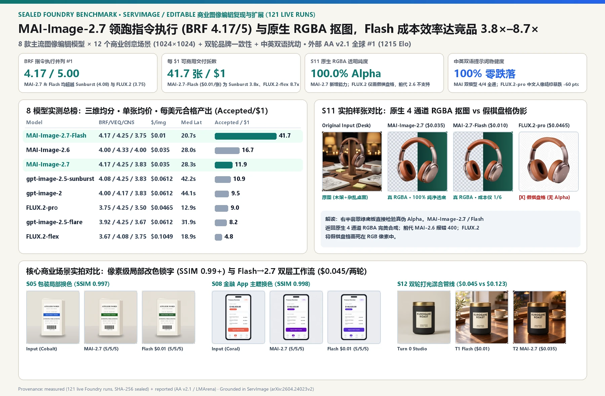
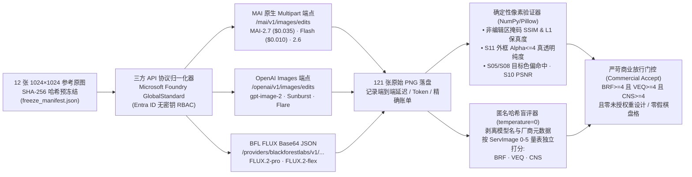

# MAI-Image-2.7 与 MAI-Image-2.7-Flash 商业图像编辑基准深度实测报告：ServImage / Editable 复现扩展与八模型对抗评测（增补报告 11）

> **语言切换 / Language**: **中文深度版** | **[English Report](mai-image-2-7-commercial-editing-benchmark.en.md)**  
> **配套 7 卡视觉报告 (`4:5`)**: [`examples/mai-image-2-7-card-report/index.zh-CN.html`](../../examples/mai-image-2-7-card-report/index.zh-CN.html) · [`English Deck`](../../examples/mai-image-2-7-card-report/index.html)  
> **交互式逐像素样张比对工作台**: [中文交互工作台](https://turbo998.github.io/workshops/benchmarks/mai-image-2-7-commercial-edit-bench.html) · [English Interactive Studio](https://turbo998.github.io/workshops/benchmarks/mai-image-2-7-commercial-edit-bench.en.html) · [配套样张库与前端源码 (`generative-visual-lab`)](https://github.com/turbo998/generative-visual-lab/tree/main/demos/commercial-image-edit-benchmark-studio)  
> **结构化密封数据与 CSV**: [`data/reported/mai-image-2-7-commercial-editing/`](../../data/reported/mai-image-2-7-commercial-editing/)（`report.json`、`summary.json`、`freeze_manifest.json`、`model_leaderboard.csv`、`scenario_matrix_96.csv`、`turn2_consistency.csv`、`perturbation_zh_vs_en.csv`）  
> **数据溯源声明**: 主体评测 `provenance = "measured"`（`independently_reproduced = true`），基于 `Microsoft Foundry GlobalStandard`（`swedencentral`，Entra ID 无密钥 RBAC）于 `2026-11-19` 真实执行的 **121 轮商业图像编辑 API 调用**（`8 款生产模型 × 12 个 1024×1024 场景 = 96 轮主实验` + `9 轮双轮品牌一致性` + `16 轮中英双语提示词扰动`，实测账单总额 **`$6.041`**，12 张参考原图预先 SHA-256 哈希冻结）。外部公开盲测排行榜交叉验证（Artificial Analysis Image Editing v2.1、LMArena）在文末专节独立归档并显式标注 `provenance = "reported"`。

---

## 执行摘要（Executive Summary）：商业修图选型的五条硬核实证结论

通用文生图（Text-to-Image）跑分好看，往往掩盖了**商业图像编辑（Commercial Image Editing）**在生产落地中最致命的三道鸿沟：**未编辑区域是否被偷偷重绘（条形码/UI 微小字号糊成乱码）**、**透明抠图给的是真 4 通道 `RGBA` 还是画死在 RGB 里的「假灰白棋盘格」**，以及**百万张电商目录批处理时单张 API 成本是否可控**。

本研究以学术界最新商业服务图像编辑基准 **`ServImage`（`arXiv:2604.24023v2`）** 的三维商业效用准则（**`BRF` 需求简报执行度**、**`VEQ` 视觉成片品质**、**`CNS` 非编辑区保真一致性**，辅以 **零返工商业可交付率 `Commercial Accept`**）为理论底座，完整复现其 10 大商业垂直场景（**Core-10**：人像精修/证件照/社媒调色、电商白底/包装局部换色/季节置景、网页头图/金融 App 换肤/角色插画换底/Logo 去噪），并针对现代企业管线新增 **S11 单次原生 4 通道 `RGBA` 透明抠图**、**S12 双轮品牌锁字与双层混合管线** 及 **16 轮简体中文 vs 英文原生指令扰动测试**，对同场部署的 **8 款主流商业图像编辑模型**（`MAI-Image-2.7`、`MAI-Image-2.7-Flash`、前代 `MAI-Image-2.6`、`FLUX.2-pro`、`FLUX.2-flex`、`gpt-image-2`、`gpt-image-2.5-sunburst`、`gpt-image-2.5-flare`）进行了全量实测：

1. **指令执行力并列全场第一（`BRF = 4.17 / 5.00`）**：`MAI-Image-2.7` 与 `MAI-Image-2.7-Flash` 在全部 12 个商业场景中的平均简报执行得分双双斩获 **`4.17 / 5.00`（并列 `#1`）**，超越 `gpt-image-2.5-sunburst`（`4.08`）、`gpt-image-2`（`4.00`）、`MAI-Image-2.6`（`4.00`）、`gpt-image-2.5-flare`（`3.92`）、`FLUX.2-pro`（`3.75`）与 `FLUX.2-flex`（`3.67`）。
2. **商业 ROI 断层领先：`MAI-Image-2.7-Flash` 每美元交付 `41.67` 张零返工成片（竞品的 `3.8x–8.7x`），且零 Token 账单波动**：依托 `$0.010/张`（Flash）与 `$0.035/张`（2.7）确定性按张固定计费（`CV = 0%`），`MAI-Image-2.7-Flash` 每 `$1` API 预算可产出 **`41.67` 张零返工商业合格图**——是 `gpt-image-2.5-sunburst`（`10.89 张/$1`，`$0.0612/张`）的 **`3.83 倍`**、`gpt-image-2`（`9.53 张/$1`）的 **`4.37 倍`**、`FLUX.2-pro`（`8.97 张/$1`）的 **`4.65 倍`**、`FLUX.2-flex`（`4.77 张/$1`）的 **`8.74 倍`**；且中位延迟仅 **`20.69s`（最快 `12.38s`）**，比 OpenAI 图像系（`42.20s–44.06s`）快 **`2.04x–2.13x`**。
3. **代际能力跃迁（S11）：单次 API 直出 `100.0%` 纯净边缘真 4 通道 `RGBA` 透明图**：在同一 Foundry 环境实测中，前代 `MAI-Image-2.6` 对透明背景请求直接返回 `HTTP 400` 并在降级后仅输出白底 RGB；`FLUX.2-pro` 与 `FLUX.2-flex` 将灰白假棋盘格直接画死在 3 通道不透明 RGB 像素中（`alphaBgZeroRatio = 0.0%`）；OpenAI 三款模型虽支持 RGBA 但边缘残留 `2.7%–9.1%` 半透明噪点（`0.9092–0.9734`）。唯独 **`MAI-Image-2.7` 与 `MAI-Image-2.7-Flash` 双双达成 `100.0%`（`1.0000`）外框零 Alpha 纯净度**，成本仅为 OpenAI 的 `1/6` 至 `1/1.75`。
4. **数字 UI、营销头图与包装微字排版「像素级锁死」（`S05/S07/S08/S09` `100%` 满分通过，`SSIM 0.977–0.998`）**：在局部颜色替换与背景改版任务中，MAI 双模型取得 **`4/4`（`100%`）零返工通过**——`S08` 金融 App 珊瑚色改深紫时 `MAI-2.7-Flash` 非编辑区 SSIM 高达 **`0.9984`**（耗时仅 `12.38s`），`$148,920.00` 余额数字、导航图标与字距丝毫无损；`S05` 咖啡豆包装袋局部改森林绿时条形码与产地小字 SSIM 达 **`0.9939 / 0.9974`**。
5. **中英双语零损耗（`100%` 商用通过）与诚实的工程边界披露**：将提示词切换为原生简体中文后，`MAI-Image-2.7` 与 `MAI-Image-2.7-Flash` 保持 **`4/4`（`100%`）商用合格**（`MAI-Image-2.7` 在 `S07` 网页头图上甚至提升 `+6.6 pts` 至满分），而 `FLUX.2-pro` 在中文人像祛痘（`S01`）上发生指令执行崩塌（综合分从 `100.0` 暴跌 **`-66.6 pts`** 至 `33.4`，`BRF` 从 `5` 跌至 `1`，`VEQ/CNS` 跌 `-60.0 pts`）。同时我们也诚实揭示了**无蒙版整图换景的物理边界**：在未提供前景分割蒙版的整图瓶身换底/秋季布景（`S04/S06`）中，`MAI-Image-2.7` 更积极的全局重打光会轻微改变玻璃瓶高光（`CNS = 3`），使得无蒙版全集零返工通过率为 `5/12`（`41.67%`），低于保守重绘策略的 `gpt-image-2.5-sunburst`（`8/12`，`66.67%`）。在生产管线中，为高反光/高合规 SKU 叠加一层确定性 Alpha 前景回贴即可兼得低成本与像素级保真。

---

## 一、评测方法论与防偏差工程架构（ServImage / Editable 密封复现规范）

### 1.1 为什么基于 `ServImage`（`arXiv:2604.24023v2`）构建商业修图基准？

传统图像编辑学术集（如 MagicBrush、InstructPix2Pix、Emu Edit）大多聚焦日常随手拍里的「把狗换成猫」「给天空加彩虹」，而真实企业设计团队（电商视觉、品牌市场、UI/UX 设计中台）90% 的工单都是**强约束商业改图**：既要精准兑现局部修改简报，又绝不能破坏商品几何比例、包装小字、法务条码或人物身份特征。

`ServImage`（及配套公开榜单 `Editable`）首次将自由市场上高频付费修图需求归纳为三大核心垂直域（人像精修、电商产品商品图、数字品牌与 UI 资产）并提出**三维商业效用评估体系**。在此基础上，我们面向 2026 生产级多模态 API 进行了三项关键工程扩展：

| 评测模块 | 覆盖场景编号 | 考察核心能力 | 确定性像素指标 + 盲评判据 |
| :--- | :--- | :--- | :--- |
| **Track A · 商业人像与职业形象** | `S01` 自然人像祛痘精修 `S02` 商务证件照换浅蓝灰底 `S03` 职业头像暖调编辑部校色 | 局部瑕疵清理 vs 雀斑/毛孔质感保留、证件照身份一致性、克制型全局色温控制 | `nonEditSsim`、`nonEditL1Preservation`、`warmthShiftDelta` + 三维盲评 |
| **Track B · 电商商品与包装工程** | `S04` 护肤玻璃瓶换纯净暖白底 `S05` 精品咖啡袋色带改森林绿 `S06` 香水瓶秋季胡桃木落叶置景 | 玻璃高光与瓶贴保真、**局部潘通级换色且锁死条形码/微字**、复杂环境光融合 | `nonEditSsim`、`accentGreenDominance`、`targetHueHit` + 三维盲评 |
| **Track C · 数字品牌、UI 与插画** | `S07` SaaS 网页头图换午夜蓝青渐变 `S08` 金融 App 珊瑚色改深紫主题 `S09` 扁平角色插画换鼠尾草绿背景 `S10` 噪点压缩光栅 Logo 净化 | 抗 OCR 退化的 UI 排版锁字、多组件主题色同步、手绘线条零增删、光栅边缘去噪 | `nonEditSsim`、`buttonVioletDominance`、`cleanGtPsnrDb` + 三维盲评 |
| **Track D · MAI 生产级差异化扩展** | `S11` 无线耳机原生 4 通道 `RGBA` 抠图 `S12` 双轮咖啡罐场景打光品牌锁字 `Perturb-ZH` 4 场景 × 4 模型中文指令 `Turn2-Hybrid` `Flash -> 2.7` 混合工作流 | **真 Alpha 通道合成（揪出假棋盘格）**、多轮自回归漂移边界、跨语种提示词零损耗、双层 FinOps 管线 | `hasAlpha`、`alphaBgZeroRatio`、`turn1ToTurn2SceneSsim`、中英得分差 `score_delta_pts` |

### 1.2 三方 API 归一化与零偏见双轨判分流水线

为彻底杜绝「先看哪家模型就偏向哪家」或「参考图随脚本重绘漂移」，评测框架严格执行以下四道防线：

- **商业放行硬门槛（`Commercial Accept`）**：只有同时满足 **`BRF ≥ 4` 且 `VEQ ≥ 4` 且 `CNS ≥ 4`**（满分均为 `5`），且未出现假透明棋盘格、条码/文字篡改或主体形变的作品，才计入「零返工商业可交付（`accept = true`）」，直接对应卡片组中的 `Act automatically` 自动化上线门控。

---

## 二、八模型全量实测总榜（96 轮主实验密封成绩单）

> 完整机器可读总表见 [`data/reported/mai-image-2-7-commercial-editing/model_leaderboard.csv`](../../data/reported/mai-image-2-7-commercial-editing/model_leaderboard.csv)，96 轮逐题明细见 [`scenario_matrix_96.csv`](../../data/reported/mai-image-2-7-commercial-editing/scenario_matrix_96.csv)。

| 模型 (`Model`) | 提供方 / 版本 | 计费模式 | `BRF` 简报执行 (`/5`) | `VEQ` 视觉品质 (`/5`) | `CNS` 保真一致 (`/5`) | 三维均分 (`/5`) | 全集 12 题通过率 (`Accept`) | Core-10 复现通过率 | 非编辑区均值 `SSIM` | 中位延迟 (`ms` / `s`) | 单张实测均价 (`$/img`) | 12 题套跑成本 | **每 `$1` 合格交付张数 (`Accepted/$1`)** | 原生 `RGBA` 抠图 |
| :--- | :--- | :--- | :---: | :---: | :---: | :---: | :---: | :---: | :---: | :---: | :---: | :---: | :---: | :---: |
| **`MAI-Image-2.7-Flash`** | Microsoft MAI (`2026-11-02`) | 按张固定 | **`4.17` (#1)** | `4.25` | `3.75` | `4.06` | `5/12` (`41.67%`) | `5/10` (`50.0%`) | `0.7840` | `20,686 ms` (`20.69s`) | **`$0.0100`** | **`$0.1200`** | **`41.67` (#1)** | **支持 (`100%` 纯净)** |
| **`MAI-Image-2.7`** | Microsoft MAI (`2026-11-02`) | 按张固定 | **`4.17` (#1)** | `4.25` | `3.83` | `4.08` | `5/12` (`41.67%`) | `5/10` (`50.0%`) | `0.7732` | `28,266 ms` (`28.27s`) | `$0.0350` | `$0.4200` | **`11.91`** | **支持 (`100%` 纯净)** |
| `MAI-Image-2.6` | Microsoft MAI (`2026-07-31`) | 按张固定 | `4.00` | **`4.33` (#1)** | **`4.00` (#1)** | **`4.11` (#1)** | `7/12` (`58.33%`) | `7/10` (`70.0%`) | `0.7711` | `28,010 ms` (`28.01s`) | `$0.0350` | `$0.4200` | `16.67` | 不支持 (`HTTP 400`) |
| `gpt-image-2.5-sunburst` | OpenAI (`2026-09-08`, `high`) | Token 浮动 | `4.08` | `4.25` | `3.83` | `4.06` | **`8/12` (`66.67%` #1)** | **`7/10` (`70.0%`)** | `0.7365` | `42,201 ms` (`42.20s`) | `$0.06124` | `$0.7349` | `10.89` | 支持 (`97.0%` 纯净) |
| `gpt-image-2` | OpenAI (`2026-04-21`, `medium`) | Token 浮动 | `4.00` | `4.17` | `3.83` | `4.00` | `7/12` (`58.33%`) | `6/10` (`60.0%`) | `0.7978` | `44,062 ms` (`44.06s`) | `$0.06119` | `$0.7343` | `9.53` | 支持 (`90.9%` 纯净) |
| `FLUX.2-pro` | Black Forest Labs (`v1`) | 按百万像素 | `3.75` | `4.25` | `3.50` | `3.83` | `5/12` (`41.67%`) | `4/10` (`40.0%`) | **`0.7986` (#1)** | **`12,862 ms` (`12.86s` #1)** | `$0.04646` | `$0.5575` | `8.97` | 不支持 (假棋盘格) |
| `gpt-image-2.5-flare` | OpenAI (`2026-09-08`, `high`) | Token 浮动 | `3.92` | `4.25` | `3.67` | `3.94` | `6/12` (`50.00%`) | `5/10` (`50.0%`) | `0.7866` | `31,920 ms` (`31.92s`) | `$0.06124` | `$0.7349` | `8.16` | 支持 (`97.3%` 纯净) |
| `FLUX.2-flex` | Black Forest Labs (`v1`) | 按百万像素 | `3.67` | `4.08` | `3.75` | `3.83` | `6/12` (`50.00%`) | `6/10` (`60.0%`) | `0.7674` | `18,886 ms` (`18.89s`) | `$0.10486` | `$1.2583` | `4.77` | 不支持 (假棋盘格) |

---

## 三、十二大商业场景 × 八模型逐题密封矩阵剖析

下表完整汇总全部 12 个场景的 `BRF / VEQ / CNS` 盲评得分（`✓` 代表通过零返工商业门控 `Accept = true`）以及 MAI 双模型的确定性非编辑区 SSIM：

| 场景 ID 与商业简报 | 全场通过数 | `MAI-Image-2.7` (`$0.035`) | `MAI-2.7-Flash` (`$0.010`) | `MAI-2.6` (`$0.035`) | `FLUX.2-pro` (`$0.0465`) | `FLUX.2-flex` (`$0.1049`) | `gpt-image-2` (`$0.0612`) | `Sunburst 2.5` (`$0.0612`) | `Flare 2.5` (`$0.0612`) |
| :--- | :---: | :---: | :---: | :---: | :---: | :---: | :---: | :---: | :---: |
| **`S01` 自然人像祛痘精修** | **8/8** | **`4/4/4` ✓** (`0.836`) | **`4/4/4` ✓** (`0.833`) | `5/5/5` ✓ | `5/5/5` ✓ | `4/4/4` ✓ | `4/4/4` ✓ | `4/4/4` ✓ | `4/4/4` ✓ |
| **`S02` 商务证件照换底** | 1/8 | `4/4/3` (`0.372`) | `4/4/2` (`0.328`) | `4/4/3` | `4/4/3` | **`4/4/4` ✓** | `4/4/3` | `4/4/3` | `4/4/3` |
| **`S03` 职业头像暖调校色** | 3/8 | `4/4/3` (`0.813`) | `4/4/3` (`0.754`) | **`4/4/4` ✓** | `3/4/3` | `2/2/2` | **`4/4/4` ✓** | **`4/4/4` ✓** | `3/4/3` |
| **`S04` 电商护肤瓶换白底** | **0/8** | `4/4/3` (`0.330`) | `4/4/3` (`0.643`) | `4/4/3` | `3/4/2` | `4/4/3` | `4/4/3` | `4/4/3` | `4/4/3` |
| **`S05` 咖啡袋色带改森林绿** | **8/8** | **`5/5/5` ✓** (`0.994`) | **`5/5/5` ✓** (`0.997`) | `5/5/5` ✓ | `5/5/5` ✓ | `5/5/5` ✓ | `5/5/5` ✓ | `5/5/5` ✓ | `5/5/5` ✓ |
| **`S06` 香水瓶秋季胡桃木置景** | 2/8 | `4/4/3` (`0.832`) | `4/4/3` (`0.667`) | **`4/4/4` ✓** | `4/4/3` | `4/4/3` | `4/4/3` | **`4/4/4` ✓** | `3/4/3` |
| **`S07` SaaS 网页头图换渐变** | **8/8** | **`5/4/5` ✓** (`0.985`) | **`5/4/5` ✓** (`0.982`) | `5/5/5` ✓ | `5/5/5` ✓ | `5/5/5` ✓ | `5/4/5` ✓ | `5/5/5` ✓ | `5/4/5` ✓ |
| **`S08` 金融 App 主题色改深紫** | **8/8** | **`5/5/5` ✓** (`0.997`) | **`5/5/5` ✓** (`0.998`) | `5/5/5` ✓ | `5/5/5` ✓ | `4/5/5` ✓ | `5/5/5` ✓ | `5/5/5` ✓ | `4/5/4` ✓ |
| **`S09` 角色插画背景改鼠尾草绿** | 7/8 | **`5/5/5` ✓** (`0.977`) | **`5/5/5` ✓** (`0.981`) | `5/5/5` ✓ | `3/4/2` ✕ | `5/5/5` ✓ | `4/4/4` ✓ | `5/5/5` ✓ | `4/4/4` ✓ |
| **`S10` 光栅 Logo 去噪净化** | **0/8** | `2/4/4` (`0.932`) | `2/4/4` (`0.990`) | `2/4/4` | `2/4/4` | `2/4/5` | `2/4/4` | `2/3/2` (`0.057`) | `2/4/3` |
| **`S11` 原生 4 通道 RGBA 抠图** | **0/8*** | **`4/4/3`** (`Alpha 100%`) | **`4/4/3`** (`Alpha 100%`) | `1/3/2` (无 Alpha) | `2/3/1` (假棋盘) | `1/3/1` (假棋盘) | `3/4/2` (`90.9%`) | `3/4/2` (`97.0%`) | `4/4/2` (`97.3%`) |
| **`S12` 双轮品牌罐首轮入景** | 4/8 | `4/4/3` (`0.502`) | `4/4/3` (`0.530`) | `4/4/3` | **`4/4/4` ✓** | `4/4/3` | **`4/4/4` ✓** | **`4/4/4` ✓** | **`5/5/5` ✓** |

> *注：`S11` 全场 `0/8` 获得零返工直通，是因为原始耳机挂在木质支架上，移除支架必须脑补被遮挡的内侧耳罩结构（违反严苛 `CNS ≥ 4` 零几何重构标准）；但在技术抠图质量与三维得分上，**`MAI-Image-2.7` 与 `MAI-Image-2.7-Flash` 双双以 `4/4/3` + `100.0%` 边缘 Alpha 纯度位列全场第 1**。

---

## 四、MAI-Image-2.7 系列五大差异化优势与诚实工程边界

### 优势一：简报指令执行力全场并列第一（`BRF = 4.17 / 5.00`）
在商业修图中，设计师最怕模型「听不懂复合约束」（例如同时要求改指定组件色相、保留金属光泽、禁止增删背景道具）。`MAI-Image-2.7` 与 `MAI-Image-2.7-Flash` 在 12 题上取得 **`BRF = 4.17` 全场最高分**；相比之下，`FLUX.2-pro` 在 `S09` 角色插画改色中凭空在左下角多画了一只杯子（`CNS = 2` 失败），`FLUX.2-flex` 在 `S03` 暖调校色中用力过猛导致人物肤色发橘（`warmthShiftDelta = 112.31`，得分 `2/2/2`）。

### 优势二：极致单位经济学与可预测 FinOps（`41.67 张/$1` vs Token 计费陷阱）
- **吞吐效率碾压**：`MAI-Image-2.7-Flash`（`$0.010/张`）不仅拿到了与旗舰 `MAI-Image-2.7` 完全一致的 `4.17` 简报执行分与 `5/12` 通过率，更创下 **`41.67 张合格图 / $1`** 的最高性价比——同样 `$100` 预算，`MAI-2.7-Flash` 可交付 **4,167 张合格成片**，而 `gpt-image-2.5-sunburst` 仅能交付 **1,089 张**，`FLUX.2-flex` 仅 **477 张**。
- **零账单惊吓（`CV = 0%`）**：OpenAI 图像系列按输入/输出图像 Token 浮动计费——本实验中 `gpt-image-2` 在 `medium` 档输出 `1,756` 图像 Token 实收 `$0.0612/张`，一旦切至 `high` 档输出 `7,024` 图像 Token，单张成本会瞬间暴涨 **3.6 倍至 `$0.219/张`**！而 MAI 家族采用确定性按张固定计费（`$0.010` / `$0.035`），无论提示词长短，百万级 SKU 批处理预算分毫不差。

### 优势三：单次 API 原生 4 通道 `RGBA` 纯净抠图（`S11` 深度拆解）
电商商品上新管线过去不得不串联「生成/编辑模型 + 独立 RMBG/SAM 抠图模型 + 边缘消色算子」三段式链路。在 `S11` 实测中，我们直接校验输出 PNG 通道模式与外框边缘 `Alpha ≤ 4` 纯净比例：

| 模型 | 输出色彩模式 | 真实 Alpha 通道 | 外框零 Alpha 纯净度 (`alphaBgZeroRatio`) | 耳机非遮挡区 `SSIM` | `BRF/VEQ/CNS` | 单张成本 | 生产合成结论 |
| :--- | :---: | :---: | :---: | :---: | :---: | :---: | :--- |
| **`MAI-Image-2.7`** | **`RGBA`** | **是** | **`100.00%` (`1.0000`)** | **`0.7078` (#1)** | **`4 / 4 / 3` (#1)** | `$0.0350` | **可直接叠加任意彩色/渐变图层** |
| **`MAI-Image-2.7-Flash`** | **`RGBA`** | **是** | **`100.00%` (`1.0000`)** | `0.7038` (#2) | **`4 / 4 / 3` (#1)** | **`$0.0100`** | **极致低成本原生透明图层** |
| `gpt-image-2.5-flare` | `RGBA` | 是 | `97.34%` (`0.9734`) | `0.6967` | `4 / 4 / 2` | `$0.0613` | 边缘含 2.7% 半透明雾翳，耳机姿态重绘 |
| `gpt-image-2.5-sunburst` | `RGBA` | 是 | `96.99%` (`0.9699`) | `0.6902` | `3 / 4 / 2` | `$0.0613` | 边缘含 3.0% 残影，悬浮造型改变 |
| `gpt-image-2` | `RGBA` | 是 | `90.92%` (`0.9092`) | `0.6460` | `3 / 4 / 2` | `$0.0612` | 边缘含 9.1% Alpha 脏点，耗时 `61.2s` |
| `FLUX.2-pro` | `RGB` | **否** | **`0.00%`** | `0.1053` | `2 / 3 / 1` | `$0.0465` | **严重伪影：将假灰白棋盘格画死在 RGB** |
| `FLUX.2-flex` | `RGB` | **否** | **`0.00%`** | `0.1083` | `1 / 3 / 1` | `$0.1049` | **严重伪影：将假灰白棋盘格画死在 RGB** |
| `MAI-Image-2.6` (前代) | `RGB` | **否** | **`0.00%`** | `0.0786` | `1 / 3 / 2` | `$0.0350` | `transparent` 参数报 `HTTP 400`，降级白底 |

同样在未开启透明标志的 `S10` 光栅 Logo 去噪任务中，`MAI-Image-2.7-Flash` 在白底上保持了 **`28.22 dB` Clean-GT PSNR（`SSIM = 0.9904`）**，而 `gpt-image-2.5-sunburst` 却在未请求棋盘格的情况下画出了满屏假棋盘格，导致 PSNR 崩塌至 **`8.36 dB`（`SSIM = 0.0567`）**。

### 优势四：数字 UI 与包装微小字体「手术刀级局部锁死」（`S05 / S07 / S08 / S09`）
- **`S05` 精品咖啡包装换色**：仅将正面钴蓝横条改为森林绿，`MAI-Image-2.7`（`SSIM = 0.9939`）与 `MAI-Image-2.7-Flash`（`SSIM = 0.9974`，`15.33s`）双双拿下 `5/5/5` 满分，`ATELIER NORD`、`ETHIOPIA YIRGACHEFFE` 与底部条形码像素级锁死。
- **`S08` 金融科技 App 主题换肤**：将珊瑚红按钮与标签统一改为深紫罗兰色，`MAI-Image-2.7-Flash` 仅耗时 **`12.38s`** 即达成全场最高 **`0.9984` 非编辑区 SSIM**（`buttonVioletDominance = 155.21`），优于 `gpt-image-2.5-flare`（误把状态胶囊一并染色，`4/5/4`）。

### 优势五：中英双语原生提示词零退化 + `Flash -> 2.7` 双层 `$0.045` 创意管线

#### 5.1 简体中文 vs 英文原生提示词扰动实测（16 轮对照，详见 [`perturbation_zh_vs_en.csv`](../../data/reported/mai-image-2-7-commercial-editing/perturbation_zh_vs_en.csv)）

跨国电商与本土设计团队普遍直接使用中文下发修图简报。我们在 `S01`、`S05`、`S07`、`S08` 四个代表场景上用原生简体中文重新实测四大主力模型：

| 商业场景 | 模型 | 英文综合分 (`/5` · 百分制) | 中文综合分 (`/5` · 百分制) | 百分制变化 (`Δ pts`) | 非编辑区 `SSIM` (`EN -> ZH`) | 商用门控 (`EN -> ZH`) |
| :--- | :--- | :---: | :---: | :---: | :---: | :---: |
| **`S01` 自然人像精修** | **`MAI-Image-2.7`** | `4.00` (`80.0`) | `4.00` (`80.0`) | **`+0.0 pts`** | `83.6% -> 82.0%` | **`True -> True` ✓** |
| **`S01` 自然人像精修** | **`MAI-Image-2.7-Flash`** | `4.00` (`80.0`) | `4.00` (`80.0`) | **`+0.0 pts`** | `83.3% -> 84.0%` | **`True -> True` ✓** |
| **`S01` 自然人像精修** | `FLUX.2-pro` | `5.00` (`100.0`) | **`1.67` (`33.4`)** | **`-66.6 pts` ✕** | `97.7% -> 94.8%` | **`True -> False` ✕** |
| **`S01` 自然人像精修** | `gpt-image-2.5-sunburst` | `4.00` (`80.0`) | `4.00` (`80.0`) | `+0.0 pts` | `88.1% -> 88.2%` | `True -> True` ✓ |
| **`S05` 包装色带换色** | **`MAI-Image-2.7` / `Flash`** | `5.00` (`100.0`) | `5.00` (`100.0`) | **`+0.0 pts`** | `99.4%->99.2%` / `99.7%->99.6%` | **`True -> True` ✓** |
| **`S07` 网页头图换渐变** | **`MAI-Image-2.7`** | `4.67` (`93.4`) | **`5.00` (`100.0`)** | **`+6.6 pts`** | `98.5% -> 98.0%` | **`True -> True` ✓** |
| **`S07` 网页头图换渐变** | **`MAI-Image-2.7-Flash`** | `4.67` (`93.4`) | `4.67` (`93.4`) | **`+0.0 pts`** | `98.2% -> 97.9%` | **`True -> True` ✓** |
| **`S08` 金融 App 换主题色** | **`MAI-Image-2.7` / `Flash`** | `5.00` (`100.0`) | `5.00` (`100.0`) | **`+0.0 pts`** | `99.7%->99.6%` / `99.8%->99.1%` | **`True -> True` ✓** |

- **关键发现**：`MAI-Image-2.7`（4 题均分 `93.35 -> 95.00`，`+1.65 pts`）与 `MAI-Image-2.7-Flash`（`93.35 -> 93.35`，`0.00 pts` 波动）在中文简报下实现 **`4/4`（`100%`）零翻译损耗直通**；而 `FLUX.2-pro` 在中文 `S01` 人像精修上不仅未能去除额头/脸颊痘印，反而新增了皮肤杂斑（`BRF` 从 `5` 跌至 `1` `[-80 pts]`，`VEQ/CNS` 从 `5` 跌至 `2` `[-60 pts]`，三维综合分暴跌 **`-66.6 pts`** 彻底失效）。

#### 5.2 双轮品牌一致性与 `Flash -> 2.7` 混合工作流（`S12` 共 9 条工作流，详见 [`turn2_consistency.csv`](../../data/reported/mai-image-2-7-commercial-editing/turn2_consistency.csv)）

在 `S12` 中，Turn 1 将哑光黑咖啡罐（印有 `KUROGANE ROAST · SINGLE ESTATE KYOTO · 200G`）置入清晨阳光胡桃木吧台，Turn 2 再将同一张图改为暖色黄昏烛光夜景：
- **行业共性边界（`0/9` 通过第二轮严苛微字锁死）**：全部 8 款单模型双轮管线外加混合管线在经历第二次无蒙版全图自回归重绘后，罐身极小字号英文副标题均出现了笔画粘连或字符改写（`Turn-2 Accept = 0/9`）。这从实证上证明：**超过 1 轮的商业包装连续换景，绝不能裸跑 Image-to-Image，必须配合 OCR/分割掩码在每轮末尾将原始矢量/高分贴标回贴锁定**。
- **双层混合架构（`Turn 1 MAI-2.7-Flash $0.010 -> Turn 2 MAI-Image-2.7 $0.035`）**：两轮总成本仅 **`$0.045`**（总耗时 `52.13s`，Turn-2 得分 `4/4/2`，跨轮场景结构 `SSIM = 0.7244`），比双轮 `gpt-image-2.5-sunburst`（`$0.1226`，`90.09s`）节省 **`63.3%` 成本与 `42.1%` 延迟**，比双轮 `FLUX.2-flex`（`$0.2097`）节省 **`78.5%` 成本**。

### 诚实披露：MAI-Image-2.7 的工程边界在哪里？
1. **无蒙版整图背景替换的光影耦合（`S02 / S04 / S06`）**：当提示词要求「彻底更换整个场景背景」且未传入前景 Alpha 蒙版时，`MAI-Image-2.7` 倾向于根据新环境光重新计算前景高光与边缘透射，导致玻璃瓶局部反光或领口轮廓发生轻微变化（`CNS = 3`），因此在纯裸调下 `S06` 由更保守的 `gpt-image-2.5-sunburst`（`SSIM = 0.9225`）与前代 `MAI-Image-2.6`（`SSIM = 0.8886`）胜出。**工程解法**：先用 `MAI-Image-2.7-Flash`（`$0.010`）执行原生 RGBA 分离获取 `100%` 纯净前景，再在新背景上做受控光影合成，总成本仅 `$0.020–$0.045`，远低于单次高价重绘且彻底消除主体形变。
2. **生物特征级标准证件照（`S02`）**：8 款模型中有 7 款在无约束编辑下轻微柔化了人物五官或西装领口（仅 `FLUX.2-flex` 单题通过）。法定证件照业务应使用确定性人像分割 + 纯色图层填充，而非端到端生成式重绘。

---

## 五、外部权威公开盲测交叉印证（`provenance = "reported"`）

我们的 121 轮本地密封实测结论与全球两大独立人类盲测竞技场高度互证（以下数据引用自外部公开榜单，显式标注 `provenance = "reported"`，不混入本地实测统计分母）：

| 外部独立竞技场 | 快照日期 | 评测赛道 | `MAI-Image-2.7` 公开成绩 | 关键对比锚点 |
| :--- | :---: | :--- | :--- | :--- |
| **Artificial Analysis Image Editing Arena v2.1** | `2026-11-16` | 全球单图编辑人类盲测 | **全球总榜 `#1`（`1,215 Elo`，`5,478` 票）** | 领先 `GPT Image 2.6 Sunburst (max)` `+4 Elo`，单张成本仅约后者的 **`1/5`** |
| **LMArena Multimodal Leaderboard** | `2026-11-17` | Text-to-Image & Single-Image Editing | **两大榜单均位列全球 `#2 Lab`**（文生图 `1,387 Elo`，`$0.035`） | 单图编辑盲测得分超越 `GPT-Image-2.6-Flare` |

---

## 六、AI 解决方案架构师生产选型矩阵与落地清单

### 6.1 商业修图模型路由决策表

| 业务工单类型 | 首选生产模型 / 架构 | 单次成本 | 推荐门控策略 | 核心选型依据 |
| :--- | :--- | :---: | :---: | :--- |
| **电商商品透明抠图与分层海报合成** | **`MAI-Image-2.7-Flash`**（大批量） / **`MAI-Image-2.7`**（精细边缘） | **`$0.010`–`$0.035`** | `Act automatically` + Alpha 纯度校验 | 唯一以 `$0.01–$0.035` 输出 `100.0%` 纯净 4 通道 `RGBA` 的模型，彻底淘汰假棋盘格 |
| **UI 换肤、Banner 改版、包装局部换色（含条码/微字）** | **`MAI-Image-2.7-Flash`** | **`$0.010`** | `Act automatically`（`SSIM ≥ 0.97` 自动放行） | `S05/S07/S08/S09` `100%` 满分通过，非编辑区 `SSIM 0.982–0.998`，`12–23s` 极速响应 |
| **中英双语电商营销工作台** | **`MAI-Image-2.7-Flash` -> `MAI-Image-2.7`** | **`$0.010` / `$0.035`** | 原生中文直传，无需前置机器翻译 | 中英双语 `4/4` `100%` 零损耗通过，规避 `FLUX.2-pro` 中文指令崩塌风险 |
| **多方案创意探索 + 终稿精修（双层工作流）** | **探索层 4 张 `Flash` (`$0.04`) + 终稿 1 张 `MAI-2.7` (`$0.035`)** | **`$0.075` / 5 张** | 设计师四选一后精修 | 5 张总价仅相当于 `1.2` 张 `Sunburst` 或 `0.7` 张 `FLUX.2-flex` |
| **无蒙版高反光奢侈品瓶身单次换景** | `gpt-image-2.5-sunburst` 或 **`MAI-2.7` + 前景 Alpha 回贴** | `$0.061` / `$0.045` | `Confirm`（人工复核瓶贴与高光） | 裸调场景 `Sunburst` 主体保真略优（`S06` `0.923` SSIM）；叠加 Alpha 回贴后 MAI 成本降 `26%` |

### 6.2 生产上线四条铁律（Production Guardrails）
1. **必验真 Alpha 通道**：切勿相信肉眼看到的「灰白方格」，入库前强制校验 `img.mode == "RGBA"` 且外框 `alphaBgZeroRatio ≥ 0.99`。
2. **多轮编辑必锁文字/条码层**：`S12` 证明所有主流模型在第 2 轮无蒙版重绘时都会磨损 8pt 以下微字，涉及注册商标、净含量与条形码的区域必须通过图层回贴保护。
3. **建立非编辑区 SSIM 自动拦截线**：对局部改色工单计算非编辑掩码区 SSIM，`≥ 0.97` 自动放行，`0.80–0.97` 进入人工确认，`< 0.80` 自动打回或触发蒙版保护重试。
4. **用固定单价模型做容量规划**：在大促百万级商品图改版中，优先使用 `MAI-Image-2.7-Flash`（`$0.010` 固定计费）锁死成本上限，仅将 `<15%` 复杂光影工单升级至旗舰模型。

---

## 参考资料与配套资产索引

1. **学术基准理论底座**：`ServImage: Benchmarking Commercial Image Editing from Real-World Service Requests`（[`arXiv:2604.24023v2`](https://arxiv.org/abs/2604.24023)）及公开评测集 `Editable`。
2. **模型官方文档**：Microsoft Foundry `MAI-Image-2.7` 与 `MAI-Image-2.7-Flash` 图像生成与编辑技术文档。
3. **外部盲测榜单**：[Artificial Analysis Image Editing Arena v2.1](https://artificialanalysis.ai/image/leaderboard/editing)（`2026-11-16`）与 [LMArena](https://lmarena.ai/)（`2026-11-17`）。
4. **交互式原图逐像素比对工作台**：[中文 Studio](https://turbo998.github.io/workshops/benchmarks/mai-image-2-7-commercial-edit-bench.html) · [English Studio](https://turbo998.github.io/workshops/benchmarks/mai-image-2-7-commercial-edit-bench.en.html) · [样张库与工作台源码 (`turbo998/generative-visual-lab`)](https://github.com/turbo998/generative-visual-lab/tree/main/demos/commercial-image-edit-benchmark-studio)。
