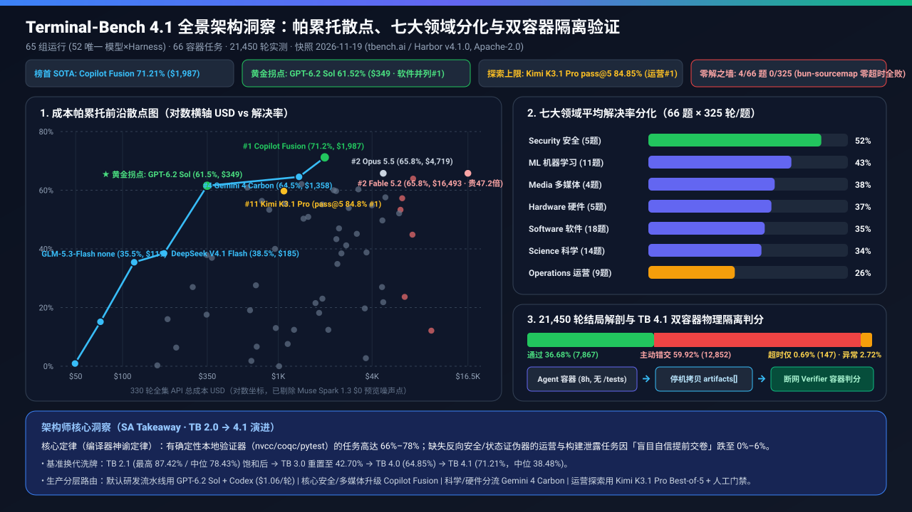
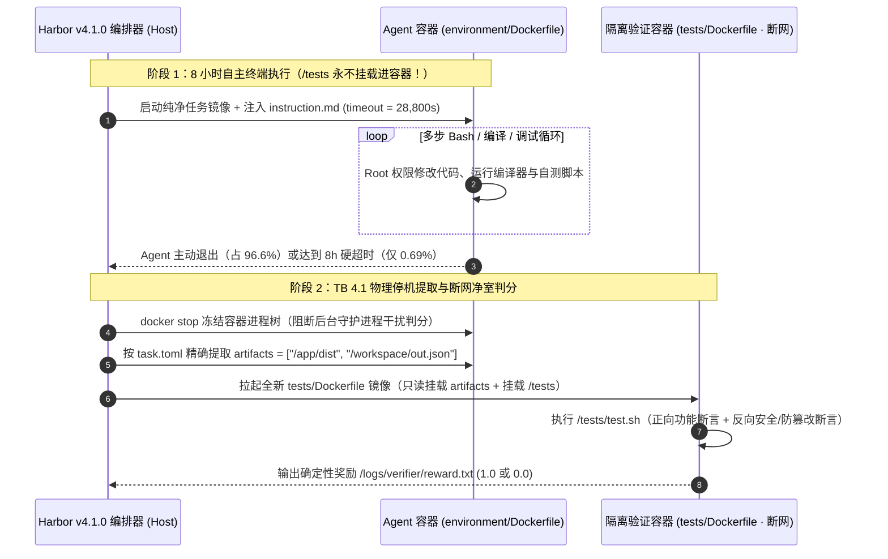
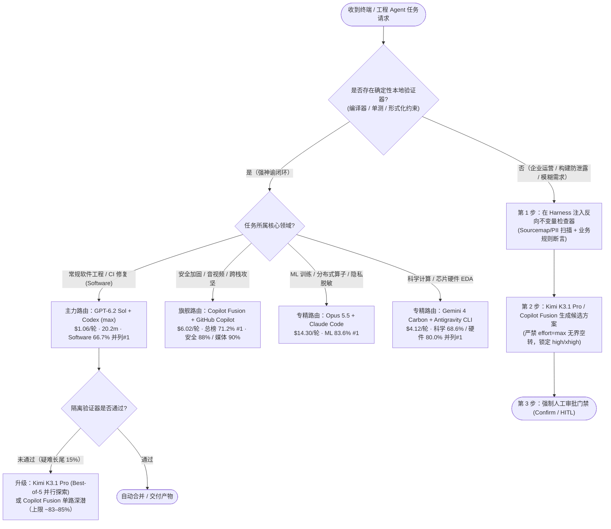

# Terminal-Bench 4.1 深度拆解与架构师洞察：排行榜、帕累托散点图与 66 任务验证器工程审计（增补报告 10）

> **语言切换 / Language**: **中文深度版** | **[English Monograph](terminal-bench-4-1.en.md)**  
> **配套 7 卡视觉报告 (`4:5`)**: [`examples/terminal-bench-4-1-card-report/index.zh-CN.html`](../../examples/terminal-bench-4-1-card-report/index.zh-CN.html) · [`English Deck`](../../examples/terminal-bench-4-1-card-report/index.html)  
> **结构化源数据与 CSV**: [`data/reported/terminal-bench-4-1/`](../../data/reported/terminal-bench-4-1/)（`leaderboard_4_1.csv`、`pareto_frontiers_4_1.csv`、`tasks_waffle_4_1.csv`、`domain_matrix_4_1.csv`、`version_evolution.csv`）  
> **数据溯源声明**: `provenance = "anonymized_reported"`（`independently_reproduced = false`），基于 [TERMINAL-BENCH (`tbench.ai`)](https://www.tbench.ai/) 与 [`harbor-framework/terminal-bench@v4.1.0`](https://github.com/harbor-framework/terminal-bench/releases/tag/v4.1.0)（Stanford / Harbor Framework / Laude Institute，Apache-2.0，快照时间 `2026-11-19T03:41:57Z`）。严格遵守防污染红线：**零原始题面文本、零 Oracle 答案脚本、零 Canary GUID 分发**。



---

## 执行摘要（Executive Summary）：读懂 Terminal-Bench 4.1 的五条硬核结论

如果说 SWE-bench Verified 测的是「给一段现成仓库打单文件/几文件 Python 补丁」，那么 **Terminal-Bench 4.1（基于 Harbor v4.1.0 容器编排引擎）** 测的就是 **AI Agent 在真实 Linux Root 终端里持续作战长达 8 小时的系统工程极限**——涵盖编译内核、H100 FP8 CUDA 算子调优、Coq/Lean 定理形式化证明、电子设计自动化（WDM/SoC）、安全取证、质谱解析与企业排班理赔。

对 **65 组官方运行记录（52 组唯一 `Model × Agent` 组合）、66 道 Docker 任务、21,450 轮密封试验** 进行交叉审计后，我们提炼出五条直接改写企业级 Agent 选型与 Harness 架构的核心结论：

1. **基准反饱和洗牌与物理级防作弊成熟（TB 2.0 → 4.1）**：当 TB 2.1 被刷到 **87.42% 榜首 / 78.43% 中位分** 陷入饱和后，TB 3.0 果断换血将最高分砸回 **42.70%（暴跌 44.72 个百分点）**；TB 4.0 重构为 66 题 7 大领域 + 8 小时统一超时；而 **TB 4.1（榜首 71.21%，中位分仅 38.48%）** 更进一步引入 `environment_mode = "separate"` **双容器物理隔离判分**——先将 Agent 容器停机提取声明产物 `artifacts[]`，再送入断网独立验证镜像运行 `tests/test.sh`，彻底堵死 Root 权限 Agent 偷看测试集或篡改判分脚本的后门。
2. **排行榜（`TABLE` 视图）真相：「模型 × 原生 Harness 协同设计」碾压裸循环，且必须敬畏 ±3% 置信区间**：前四名被**四个截然不同的第一方重型 Harness** 包揽——`#1 Copilot Fusion + GitHub Copilot (71.21% ± 2.88%)`、`#2 Opus 5.5 / Fable 5.2 + Claude Code (65.76%)`、`#4 Gemini 4 Carbon + Antigravity CLI (64.55%)`（紧随其后 `#6/#7` 为 `Codex`）。相比之下，极简 `mini-swe-agent` 11 组运行最高仅 **26.97%**（中位 7.58%–18.18%），却因缺乏上下文剪枝与目录索引在单轮吞掉高达 **14.16B Token**。同时，`#2–#5`（65.76%–63.94%）与 `#6–#12`（62.12%–59.70%）均处于 95% 置信区间重叠带，脱离置信区间与成本谈「高 1 分谁更强」纯属统计噪音。
3. **散点图（`PARETO` 视图）经济学：`$349` 黄金拐点、47.2 倍同级成本差与「过度思考税」**：在剔除 `$0.00` 未定价预览噪声（`#53 Muse Spark 1.3`）后，商业最优档共构成 **7 点成本帕累托前沿**。其中 **`#7 GPT-6.2 Sol + Codex (max)` 以 `$349.16`（`$1.06/轮`、1.09B Token、20.2 分钟均耗）斩获 `61.52%`**，不仅以 **榜首 17.6% 的成本拿到 86.4% 的总分**，更在第一大类 **Software 软件工程（18 题）上以 `66.67%` 追平榜首 Copilot Fusion、反超 `#2 Opus 5.5 (52.22%)` 达 `+14.45` 个百分点**；而并列第 2 的 `Fable 5.2` 却烧掉惊人的 **`$16,492.76`（贵出 47.2 倍！）**。更反直觉的是，盲目拉满 `effort = max` 在多款旗舰上触发**档位倒挂（Overthinking Tax）**：`Fable 5.1` 从 `xhigh` 升至 `max` 多花 `$1,371.46` 反而跌 `0.31` 分；`Opus 5` 升至 `max` 反而跌 `1.21` 分。
4. **66 道任务与 21,450 轮结局解剖：「编译器神谕定律」与「虚假提前交卷综合征」**：七大领域解决率呈现两倍断层：`Security (52%)` > `ML (43%)` > `Media (38%)` > `Hardware (37%)` > `Software (35%)` > `Science (34%)` > **`Operations (26%)`**。凡具备毫秒级确定性编译器/证明器反馈（`nvcc`、`coqc`、`pytest`）的硬核题，解决率高达 **66%–78%**；反之，在全部 21,450 轮试验中，**真正因 8 小时耗尽超时的仅占 `0.69%`（147 轮），而主动提前退出却判分失败的高达 `59.92%`（12,852 轮，是超时的 87 倍！）**。最典型的 `bun-sourcemap-leak` 创下 **325 轮 0 通过、0 超时、325 次 100% 自信错交**——打败现代 Agent 的不是算力时间不够，而是缺乏「反向不变量证伪器」导致的盲目自信交卷。
5. **并行采样上限（`pass@5`）与领域专精黑马**：`#11 Kimi K3.1 Pro + Claude Code ($1,086.66)` 单次 `pass@1` 为 `59.70%`，但 5 轮并集 **`pass@5` 暴涨 `+25.15 pts` 登顶全场第 1（`84.85%`，覆盖 56/66 题）**，不仅以 **`64.44%` 夺得最难领域 Operations 冠军**，更是地球上**唯一攻克 `cargo-flight-dispatch`（3/325）** 且在 `medical-claims-processing` 上拿下 **5/5 满分**的模型。

---

## 一、基准演进纵览：从 TB 2.1 饱和危机到 TB 4.1 持续语义化架构

许多团队在引用智能体榜单时忽略了一个致命陷阱：**静态基准半衰期已缩短至 4–6 个月**。Terminal-Bench 官方跨版本历史数据清晰记录了这场「饱和—硬重置—隔离加固」的三次跃迁：

| 版本 | 收录运行数 | 中位解决率 | 榜首最高解决率 | 当代榜首组合 (`Model + Agent`) | 榜首全集成本 | 核心架构里程碑 |
| :--- | :---: | :---: | :---: | :--- | :---: | :--- |
| **TB 2.0** | 142 | 44.33% | 84.72% | `GPT-5.5 + NexAU-AHE` | — | 初代 89 题容器化终端评测集，确立真实 Bash 交互范式 |
| **TB 2.1** | 22 | **78.43%** | **87.42%** | `GPT-6 Astra + Codex` | $773.50 | **进入饱和区**：中位分逼近 80%，区分度急剧退化 |
| **TB 3.0** | 12 | 21.08% | **42.70%** | `Opus 5 + mini-SWE-agent` | $5,818.20 | **硬核重置洗牌**：淘汰饱和旧题，榜首一夜回落 44.72 个百分点 |
| **TB 4.0** | 57 | 37.27% | 64.85% | `Opus 5.5 + Claude Code` | $4,718.65 | 重构 **66 题 × 7 领域**、统一 **8 小时超时**，确立 `x.y.z` 语义化版本 |
| **TB 4.1** | **65** | **38.48%** | **71.21%** | **`Copilot Fusion + GitHub Copilot`** | **$1,987.33** | **`environment_mode = "separate"` 双容器物理隔离判分**，根除测试泄露 |

### 个人洞察 1：`x.y.z = Rerun . Regrade . Reuse` 是企业级自建评测库的最佳范本

在企业内部维护黄金评测集（Golden Eval Suite）时，最头疼的莫过于「修了一个判分正则表达式，难道要把所有模型重跑一遍烧掉几万美元？」。Terminal-Bench 4.0/4.1 提出的 **连续基准语义化版本契约（Continuous Benchmark Semantic Versioning）** 给出了教科书级解法：
- **`x`（Major 主版本 = Rerun 全量重跑）**：题库分布、环境语义或提示词发生破坏性变更，历史轨迹作废，必须重新推理；
- **`y`（Minor 次版本 = Regrade 隔离重判 / 局部增量）**：例如从 `4.0` 到 `4.1`，修正验证器边界或将受影响题目迁移至独立判分容器，对未受污染的有效产物直接确定性重判（Regrade）或最小化补跑；
- **`z`（Patch 补丁版本 = Reuse 直接复用）**：仅涉及文档、元数据或非判分基础设施清理，100% 复用既有密封分数。

---

## 二、排行榜深度点评（`TABLE` 视图）：四大 Harness 割据、统计并列带与缓存真相

### 2.1 TB 4.1 头部旗舰与关键锚点总表（全集 65 组运行代表性切片）

> 完整 65 行明细（含精确输入/输出/缓存 Token 与 4 维帕累托标记）见 [`data/reported/terminal-bench-4-1/leaderboard_4_1.csv`](../../data/reported/terminal-bench-4-1/leaderboard_4_1.csv)。每组运行包含 `66 题 × 5 轮 = 330 轮` 独立容器试验。

| 排名 | 模型 (`Model`) | Harness (`Agent`) | 推理档位 | `pass@1` 解决率 (±95% CI) | 通过轮数 | `pass@2` | `pass@5` (探索上限) | 330 轮总成本 | 单次均价 | 总 Token (KV 缓存命中率) | 单轮均耗 | 架构定位标签 |
| :---: | :--- | :--- | :---: | :---: | :---: | :---: | :---: | :---: | :---: | :---: | :---: | :--- |
| **#1** | **Copilot Fusion** | **GitHub Copilot** | `max` | **71.21% ± 2.88%** | **235/330** | **78.33%** | 83.33% | $1,987.33 | $6.02 | 3.32B (94.84%) | 4,234s | **全场总冠军 & 三维帕累托顶点** |
| **#2** | **Opus 5.5** | **Claude Code** | `max` | **65.76% ± 3.11%** | 217/330 | 74.09% | 80.30% | $4,718.65 | $14.30 | 8.03B (96.91%) | 4,790s | **ML 领域第 1 (83.6%) · 唯一攻克匿名化** |
| **#2** | **Fable 5.2** | **Claude Code** | `max` | **65.76% ± 2.85%** | 217/330 | 72.73% | 78.79% | **$16,492.76** | **$49.98** | 15.73B (95.47%) | 7,333s | **极端成本反模式（Sol 的 47.2 倍）** |
| **#4** | **Gemini 4 Carbon** | **Antigravity CLI** | `high` | **64.55% ± 3.23%** | 213/330 | 73.48% | 78.79% | **$1,358.25** | $4.12 | 3.78B (93.82%) | 3,496s | **高阶成本帕累托 · 科学/硬件并列第 1** |
| **#5** | **Sonnet 5.5** | **Claude Code** | `max` | 63.94% ± 3.00% | 211/330 | 71.67% | 80.30% | $7,333.64 | $22.22 | **19.41B** (96.64%) | 7,432s | 长程轨迹膨胀（比 Opus 5.5 贵 55%） |
| **#6** | **GPT-6.2 Astra** | **Codex** | `max` | 62.12% ± 2.30% | 205/330 | 66.67% | 72.73% | $1,409.14 | $4.27 | **1.12B (97.03%)** | 1,350s | **Software 领域第 1 (67.8%) · Token 帕累托** |
| **#7** | **GPT-6.2 Sol** | **Codex** | `max` | **61.52% ± 2.75%** | 203/330 | 68.03% | 72.73% | **$349.16** | **$1.06** | **1.09B** (96.76%) | **1,214s** | **★ 商业黄金拐点（Software 66.7% 并列#1）** |
| **#8** | **GPT-6.1 Sol** | **Codex** | `max` | 60.91% ± 2.97% | 201/330 | 68.48% | 74.24% | $634.24 | $1.92 | 1.46B (94.79%) | 3,177s | 上代主力（6.2 Sol 提速 2.6x、降本 45%） |
| **#9** | **GPT-6 Astra** | **Codex** | `max` | 60.30% ± 2.82% | 199/330 | 67.12% | 72.73% | $3,267.18 | $9.90 | 1.53B (95.85%) | 2,796s | 比同门 `high` 档多花 $998 仅多对 1 轮 |
| **#11** | **Kimi K3.1 Pro** | **Claude Code** | `max` | 59.70% ± 4.18% | 197/330 | **74.70%** | **84.85%** | $1,086.66 | $3.29 | 3.16B (96.60%) | **123s** | **★ `pass@5` 全场第 1 · Operations 冠军 (64.4%)** |
| **#33** | **DeepSeek V4.1 Flash 1017** | **Claude Code** | `max` | 38.48% ± 3.76% | 127/330 | 50.61% | 65.15% | **$184.89** | $0.56 | 8.19B (94.71%) | 148s | 全榜精确中位数锚点 · 百元级帕累托 |
| **#37** | **GLM-5.3-Flash** | **Claude Code** | `none` | 35.45% ± 3.56% | 117/330 | 46.36% | 56.06% | **$118.74** | **$0.36** | 2.92B (97.01%) | 6,210s | 非推理直出轻量帕累托极值 |
| **#41** | **MiMo V2.6 Pro** | **mini-swe-agent** | `none` | 26.97% ± 3.61% | 89/330 | 38.18% | 53.03% | $282.32 | $0.86 | 7.79B (94.47%) | 168s | 极简 `mini-swe-agent` 阵营天花板 |
| **#53** | **Muse Spark 1.3** | **Muse Code** | `xhigh` | 14.85% ± 3.00% | 49/330 | 22.58% | 34.85% | **$0.00*** | $0.00* | 9.01B (96.97%) | 4,342s | *免费预览未计费，伪造 `$0` 帕累托原点 |

### 2.2 三层深度点评：为什么单看总分排名会严重误导架构选型？

1. **Harness 不是「薄壳胶水」，而是决定 35–44 个百分点生死的「认知操作系统」**：
   把全榜 65 组运行按 Agent Harness 聚合后，代差触目惊心：
   - **第一方工程级 Harness**：`GitHub Copilot`（71.21%）、`Claude Code`（28 组运行，最高 65.76%，中位 43.33%）、`Antigravity CLI`（4 组运行，最高 64.55%，中位 56.36%）、`Codex`（15 组运行，最高 62.12%，中位 53.33%）。它们内置了工作区符号检索、精确文件补丁工具、长输出截断保护、后台进程守护与结构化上下文压缩。
   - **学术极简循环（`mini-swe-agent` / `mini-SWE-agent`）**：共 11 组运行，最高仅 **26.97%**，中位仅 **7.58%–18.18%**，但平均每次全集运行却倾泻了 **9.20B–14.16B Token**（例如 `Gemini 3.8 Flash + mini-SWE-agent` 仅得 18.18%，却烧掉 17.19B Token；`Inkling Small 2 + mini-swe-agent` 仅得 13.03%，却烧掉 27.47B Token）。原因在于裸 Bash 循环把海量编译日志、`cat` 全文与二进制报错原封不动塞进历史消息，迅速污染注意力窗口。
2. **95% 置信区间（CI）揭示三大「统计同级梯队」**：
   由于每道题测 5 轮、共 330 轮伯努利试验，头部模型的 95% CI 普遍在 **±2.30% 至 ±4.18%** 之间：
   - **SOTA 独一档（Tier 0）**：`#1 Copilot Fusion (71.21% ± 2.88%)` 领先第 2 名 **+5.45 个百分点**（多解出 18 轮），是唯一突破 70% 大关的组合；
   - **第一集团并列带（Tier 1A，`63.9%–65.8%`）**：`#2 Opus 5.5 (65.76%)`、`#2 Fable 5.2 (65.76%)`、`#4 Gemini 4 Carbon (64.55%)`、`#5 Sonnet 5.5 (63.94%)` 彼此差距不足 1.82 个百分点，完全落在置信误差带内——但成本却从 **`$1,358` 横跨到 `$16,493`（相差 12.1 倍）**！
   - **高性价比主力并列带（Tier 1B，`59.7%–62.1%`）**：`#6 GPT-6.2 Astra (62.12%)`、`#7 GPT-6.2 Sol (61.52%)`、`#8 GPT-6.1 Sol (60.91%)`、`#9–#11 GPT-6 Astra (60.30%–59.70%)`、`#11 Kimi K3.1 Pro (59.70%)`。其中 `GPT-6.2 Sol` 仅花 **`$349.16`** 就站稳 61.5% 阵营。
3. **Token 账本审计发现：94%–97% 的前缀缓存命中率是终端 Agent 生存命脉**：
   对全榜 Token 字段做恒等式审计（`total_input_tokens = total_tokens - output_tokens`）可见，头部 Agent 每轮需要数十至上百步 Shell 交互，累计输入高达 `1.07B–19.23B` Token，但 **`cached_input_tokens / total_input_tokens` 普遍高达 `93.82%–97.03%`**（`Codex + GPT-6.2 Astra` 达 **97.03%**，真正未命中缓存的新增输入仅 `32.6M` Token！）。**架构启示**：任何破坏前缀确定性的设计（如在 System Prompt 顶部注入每秒变化的动态时间戳、无序排列 MCP 工具列表）都会击穿 KV Cache，使终端 Agent 的真实账单瞬间暴涨 **8–15 倍**。

---

## 三、散点图深度解析（`PARETO` 视图）：黄金拐点、过度思考税与三维前沿

在 `tbench.ai/?view=pareto` 散点视图中，横轴可切换为 **Cost（总成本）**、**Tokens（总 Token）** 或 **Duration（平均耗时）**，纵轴为解决率。通过严格凸包单调递增筛选（即仅保留「不存在任何更便宜/更省/更快且得分更高对手」的支配解），我们得到完整的三维帕累托前沿：

### 3.1 商业成本帕累托前沿（`cost > $0`，完整明细见 `pareto_frontiers_4_1.csv`）

| 帕累托阶梯 | 模型 + Harness (`effort`) | 解决率 (`pass@1`) | `pass@5` | 330 轮总成本 | 单次解决均价 (`$/solve`) | 边际跃迁性价比解读 |
| :---: | :--- | :---: | :---: | :---: | :---: | :--- |
| **P1 极低门槛** | `Inkling Small + mini-swe-agent (none)` | 0.91% | 3.03% | $49.55 | $16.52 | 仅解出 3 轮，纯底线参考点 |
| **P2 入门可用** | `GPT-6 Luna + Codex (max)` | 15.15% | 28.79% | $72.14 | $1.44 | 加 $22.59 换取 +14.24 pts |
| **P3 百元闪击** | `GLM-5.3-Flash + Claude Code (none)`* | 35.45% | 56.06% | **$118.74** | **$1.01** | *全档位曲线节点（最佳档曲线对应 `Muse Ember` $157.18 / 30.61%） |
| **P4 中位守门员** | `DeepSeek V4.1 Flash 1017 + Claude Code (max)` | 38.48% | 65.15% | **$184.89** | $1.46 | 仅用 $0.56/轮达到全榜中位线 |
| **P5 ★ 黄金拐点** | **`GPT-6.2 Sol + Codex (max)`** | **61.52%** | **72.73%** | **$349.16** | **$1.72** | **仅多花 $164 即暴涨 +23.04 pts！全场斜率陡峭度之王** |
| **P6 次顶旗舰** | `Gemini 4 Carbon + Antigravity CLI (high)` | 64.55% | 78.79% | $1,358.25 | $6.38 | 多花 $1,009 换取 +3.03 pts（每百分点 $333） |
| **P7 绝对 SOTA** | **`Copilot Fusion + GitHub Copilot (max)`** | **71.21%** | **83.33%** | **$1,987.33** | **$8.46** | 多花 $629 再涨 +6.66 pts，登顶全部三维前沿终点 |

### 3.2 散点图四大反直觉工程洞察

1. **为什么 `GPT-6.2 Sol + Codex ($349.16)` 是无可争议的「商业黄金拐点（Golden Elbow）」？**
   观察上方阶梯斜率：从 `DeepSeek V4.1 Flash ($184.89, 38.48%)` 到 `GPT-6.2 Sol ($349.16, 61.52%)`，每多投入 `$7.13` 就能买到 `+1.0` 个百分点的全集解决率；而一旦跨过 `GPT-6.2 Sol` 继续往右上角走，从 `61.52%` 推高到 `64.55%`（`Gemini 4 Carbon`）每百分点边际成本骤升至 **`$333`（贵出 46.7 倍）**！而散点图最右侧的 `#2 Fable 5.2 ($16,492.76)` 与 `#5 Sonnet 5.5 ($7,333.64)` 更是深陷「高耗低效被支配区（Dominated Quadrant）」——花掉 `GPT-6.2 Sol` **47.2 倍和 21.0 倍**的预算，总分仅高出 `4.24` 和 `2.42` 个百分点。
2. **「过度思考税（Overthinking Tax）」实锤：长程终端里 `max` 推理档位可能负优化！**
   在单轮数学竞赛（AIME/GPQA）中，推理 Token 越多通常准确率越高；但在长达数小时的多步 Bash 交互中，散点图同一模型的多档位轨迹揭露了**倒 U 型反转**：
   - **`Fable 5.1 + Claude Code`**：`medium (53.94%, $2,833)` → `high (54.85%, $3,985)` → **`xhigh (57.58%, $4,872.04, 3,202s)`** → **`max (57.27%, $6,243.50, 3,894s)`** —— 开启 `max` 多烧掉 **`$1,371.46`（+28.1%）**、慢了 11.5 分钟，准确率反而**倒退 0.31 个百分点**！
   - **`Opus 5 + Claude Code`**：`low (34.85%, $2,394)` → `medium (45.15%, $3,192)` → `high (49.70%, $4,662)` → **`xhigh (53.33%, $6,086.22)`** → **`max (52.12%, $5,969.11)`** —— `max` 比 `xhigh` 慢 278 秒且**倒退 1.21 个百分点（少对 4 轮）**。
   - **`GPT-6 Astra + Codex`**：`low (50.91%, $1,557)` → `medium (55.15%, $1,915)` → **`high (60.00%, $2,269.42)`** → `xhigh (59.70%, $2,350.51)` 微跌 → `max (60.30%, $3,267.18)` 多花 `$997.76` 仅多对 1 轮。
   - **机理剖析**：在容器终端里，外部环境本身就是最真实的模拟器。`max` 档位让模型在敲下一行验证命令前做冗长的内心推演，不仅极易触发长上下文摘要压缩（Compaction）冲掉前期的关键配置线索，还常在任务尾声引发「自我怀疑式重构」，把原本已经能过的代码改坏。
3. **横向并行扩展（Parallel `Best-of-5`）远胜纵向堆砌单次重型推理**：
   把 `GPT-6.2 Sol + Codex` 独立并行跑满 5 次，总账单不过 `5 × $349.16 = $1,745.80`，配合确定性验证器筛选后 `pass@5` 解决率高达 **72.73%**——不仅超越单次 `#2 Opus 5.5 ($4,718.65, 65.76%)` 与 `#2 Fable 5.2 ($16,492.76, 65.76%)`，甚至在总成本还低 `$241` 的情况下越过了单次 `#1 Copilot Fusion (71.21%)`！而 **`Kimi K3.1 Pro` 更是展现出惊人的探索多样性**：单次 `pass@1` 59.70%，5 次并集直接冲上 **84.85%（66 题攻克 56 题，全场第 1）**。
4. **警惕 `$0.00` 预览噪声对帕累托曲线的视觉绑架**：
   `#53 Muse Spark 1.3 + Muse Code` 实际消耗 `9.01B` Token，但因预览期 API 标价为 `$0.00`，在未过滤散点图上直接占据 `(x=0, y=14.85%)`，把 `$49.55` 的 `Inkling Small` 挤出几何前沿。任何企业级 FinOps 看板在绘制帕累托曲线前，必须强制按**标准商业牌价折算影子成本（Shadow Pricing）**或过滤 `cost == 0` 预览点。

---

## 四、66 道 Agent 测试任务与验证器深度剖析：编译器神谕定律与零解之墙

### 4.1 七大领域难度金字塔与冠军归属矩阵

Terminal-Bench 4.1 共包含 **66 道容器化任务**（63 道纯 CPU 任务 + 3 道 H100 GPU 任务，统一 8 小时上限），每题跨 65 组运行累计测试 **325 轮**（合计 `66 × 325 = 21,450` 轮）：

| 领域 (`Domain`) | 任务数 | 占题库比 | 全场平均解决率 | 最高解决率代表任务 | 最低解决率（0%–6% 极难任务） | 该领域单项冠军组合 (`Model + Harness`) |
| :--- | :---: | :---: | :---: | :--- | :--- | :--- |
| **1. Security（安全攻防）** | 5 | 7.6% | **52%** | `shadow-relay` (70%), `secure-log-parser` | 全部任务均 >=35% | **`#1 Copilot Fusion` / `#5 Sonnet 5.5` / `#9 GPT-6 Astra` (88.0%)** |
| **2. ML（机器学习与算子）** | 11 | 16.7% | **43%** | `mp-checkpoint-consolidation` (**78%**), `fp8-rmsnorm-gemm` (**66%**) | `vllm-deepseek-streaming` (**6%**, 21/325) | **`#2 Opus 5.5 + Claude Code` (83.64%)** |
| **3. Media（音视频与排版）** | 4 | 6.1% | **38%** | `layout-config-recreation2` (**73%**) | `music-harmony` (17%, 56/325) | **`#1 Copilot Fusion` / `#9 GPT-6 Astra` (90.0%)** |
| **4. Hardware（芯片与 CAD）** | 5 | 7.6% | **37%** | `wdm-design` (**75%**), `retro-console-soc` (55%) | `freecad-impeller` (**1%**, 4/325) | **`#2 Opus 5.5` / `#4 Gemini 4 Carbon` / `#6 GPT-6.2 Astra` (80.0%)** |
| **5. Software（软件工程）** | **18** | **27.3%** | **35%** | `risk-scorer-replay` (**67%**) | **`bun-sourcemap-leak` (0%)**, **`ontology-kg-querying` (0%)**, `data-anonymization` (**0.3%**, 1/325) | **`#6 GPT-6.2 Astra` (67.78%)** · `#1 Fusion` & `#7 6.2 Sol` (66.67% 并列第2) |
| **6. Science（形式化与自然科学）** | 14 | 21.2% | **34%** | `coq-block-bound` (**74%**), `biped-contact-dynamics` (43%) | **`glycan-ms2-elucidation` (0%)**, `foodstuff-beta-activity` (**1%**, 4/325) | **`#1 Copilot Fusion` & `#4 Gemini 4 Carbon` 并列 (68.57%)** |
| **7. Operations（企业排班与运营）** | 9 | 13.6% | **26%** | `telecom-entity-resolution` (**71%**) | **`freight-dispatch-shift` (0%)**, `cargo-flight-dispatch` (**1%**, 3/325), `medical-claims` (**6%**, 20/325) | **`#11 Kimi K3.1 Pro + Claude Code` (64.44%，断层领先 +8.9 pts!)** |

### 4.2 个人核心洞察 2：「编译器神谕定律（The Compiler-Oracle Feedback Law）」

初看任务表，几乎所有工程师都会产生一个强烈的反差疑问：
> **为什么写 H100 FP8 CUDA 融合算子（`fp8-rmsnorm-gemm` 解决率 66%）和写 Coq 机器可验证数学证明（`coq-block-bound` 解决率 74%），反而比处理货运交接班（`freight-dispatch-shift` 0%）或排查前端构建产物的 Sourcemap 泄露（`bun-sourcemap-leak` 0%）容易得多？！**

答案揭示了支配当代 Coding Agent 能力边界的第一性定律——**编译器神谕定律（Compiler-Oracle Feedback Law）**：

1. **强局部神谕任务（高解决率 66%–78%）**：在 Coq/Lean 定理证明、CUDA 算子优化、PyTorch 分布式 Checkpoint 合并中，容器内天然存在一个**零幻觉、毫秒级响应、完备等价于最终判分标准的本地验证器（Local Sound Oracle）**。只要 `coqc` 编译通过且无 `Admitted`，证明在数学上就是 100% 正确的；只要 `nvcc` 跑通数值对齐与基准测速，算子就是合格的。8 小时超时预算在这里直接转化为**高确定性的有向搜索树**。
2. **弱神谕 / 反向安全不变量任务（0%–1% 零解叹息之墙）**：再看全部 21,450 轮试验的结局分布——
   - **通过（Pass）**：`7,867` 轮（`36.68%`）
   - **主动交卷但判分失败（Voluntary Fail）**：**`12,852` 轮（`59.92%`）**
   - **8 小时超时（Timeout）**：**仅 `147` 轮（`0.69%`）**！
   - **运行时异常（Error）**：`584` 轮（`2.72%`）

   请重点盯住这组震撼的数据对比：
   - **`bun-sourcemap-leak`（Software，0/325）**：`pass = 0`，**`fail = 325`，`timeout = 0`**！整整 325 次尝试，没有任何一个 Agent 耗尽时间，100% 的 Agent 都在几十分钟内「自信满满地宣布修复完毕」，然后 100% 倒在隔离验证器的反向泄露检查下（漏掉了某条构建产物链路或边缘 Bundle 中的源码映射暴露）。
   - **`freight-dispatch-shift`（Operations，0/325）**：`pass = 0`，**`fail = 317`，`timeout = 0`**！在多班次货运调度交接中，隐含跨表业务规则、时区/班次边界与部分可观测状态，没有编译器替 Agent 报错，Agent 写出看似合理的排班表便立即交卷。
   - **`glycan-ms2-elucidation`（Science，0/325）** 与 **`ontology-kg-querying`（Software，0/325，315 败 / 10 超时）**：前者需要多级串联质谱碎片拓扑推演（一处分支误判则全盘皆错且无本地报错），后者在复杂本体语义图谱推理上因隐式公理闭合语义分歧全军覆没。
   - **唯一幸存者的启示**：
     - `data-anonymization`（`1/325`）：全场仅 **`#2 Opus 5.5`** 对了 1 轮，其余 321 轮全部因为「以为脱敏干净了，实则残留准标识符重识别风险」而主动错交；
     - `cargo-flight-dispatch`（`3/325`）与 `medical-claims-processing`（`20/325`）：**`#11 Kimi K3.1 Pro`** 独占航空货运调度全部 3 次通关，并在医疗理赔上打出 **5/5 满分**（其余 64 组运行合计仅 15/320 = 4.7%）；
     - `vllm-deepseek-streaming`（`21/325`）：前十名欧美闭源重型组合（`Copilot Fusion`、`Opus 5.5`、`Fable 5.2`、`Gemini 4 Carbon`、`GPT-6.2 Sol`）竟然全部 **0/5**，反而是 `#11 Kimi K3.1 Pro (4/5)` 与多款轻量级/开源生态模型解出——印证了特定推理引擎流式分块（Chunked Reasoning Parser）协议细节存在鲜明的训练生态特化效应。

### 4.3 Harbor v4.1.0 `environment_mode = "separate"` 双容器隔离验证架构

为什么 TB 4.1 专门为验证器升级了一次 Minor 版本？下图展示了传统同容器判分与 TB 4.1 双容器物理隔离的本质差异：



**对企业自建 Agent 沙箱的直接价值**：在单容器架构下，给 Agent 赋予 `root` 或 `sudo` 权限意味着它可以挂载探测、修改系统时钟、`LD_PRELOAD` 劫持动态库甚至改写测试桩。Harbor v4.1.0 的「**先停机、拷产物、异构净室断网判分**」模式，应当成为所有企业 L3/L4 研发与安全评测流水线的强制标准。

---

## 五、核心高频问答（FAQ：面向架构师与技术决策者）

### Q1：我们团队准备采购日常主力 Coding Agent 模型，该买榜首 Copilot Fusion、Opus 5.5 还是 GPT-6.2 Sol？
**答：采用「85% 流量走黄金拐点 + 15% 疑难任务升级路由」的双层架构，切勿全量单压高价模型。**
- **默认研发底座（85% 日常 PR / 单测 / 重构 / 微服务开发）**：首选 **`GPT-6.2 Sol + Codex`**。它在最核心的 **Software（18 题）领域以 `66.67%` 与榜首 `Copilot Fusion` 并列第 1**，反超 `#2 Opus 5.5 (52.22%)` 整整 **14.45 个百分点**，而单轮成本仅 **`$1.06`**（仅为 `Opus 5.5` 的 `1/13.5`、`Fable 5.2` 的 `1/47.2`），平均 20.2 分钟即可收工。
- **高难度升级通道（15% 跨栈疑难杂症 / 安全加固 / 复杂多媒体与科学任务）**：当主力层本地测试未过或涉及安全合规时，自动升级至 **`Copilot Fusion + GitHub Copilot`（全场 71.21% #1，安全 88%、多媒体 90%）**；若聚焦 **ML 训练与 CUDA 算子** 则分流 **`Opus 5.5 + Claude Code`（ML 83.64% #1）**；若聚焦 **科学计算与硬件 EDA** 则分流 **`Gemini 4 Carbon + Antigravity CLI`（科学 68.57% / 硬件 80.0% 并列 #1，仅 $4.12/轮）**。

### Q2：既然 TB 4.1 给足了 8 小时超时，为什么不能把线上 Agent 超时也设成 8 小时、推理档位全开 `max`？
**答：两个动作都会造成严重的生产反效果。**
1. 数据证明 **99.31% 的试验根本用不到 8 小时**（仅 0.69% 超时），真正致命的是 `59.92%` 的「虚假提前交卷」。与其放宽单次挂钟上限，不如在 Agent 准备声明完成时插入一道 **Harness 提交前强制核验钩子（Pre-Exit Adversarial Gate）**。
2. `Fable 5.1` 与 `Opus 5` 的实测数据证明，长程终端开启 `max` 会付出「过度思考税」（成本涨 28% 甚至准确率倒退 `0.31–1.21 pts`）。生产终端任务建议默认锁定 **`high` 或 `xhigh`**，把省下的预算投入 **3–5 路独立并行采样（Best-of-N）**。

### Q3：为什么企业运营类（Operations）任务平均解决率只有 26%，我们还能在供应链/排班/理赔场景落地 Agent 吗？
**答：能落地，但必须从「端到端自治 Agent」改造为「规则编译神谕 + 多路采样提案 + 人工终审」架构。**
Operations 垫底的根源不是模型不会写 Python/SQL，而是企业运营存在大量**隐式硬约束**（跨班次连续工时上限、航司危险品配载互斥、医疗保险免赔额叠加顺序）。落地秘诀有二：
1. **把业务规则显式编码为确定性本地校验器（Constraint Verifier）**：人为制造「编译器神谕」，让 Agent 每次生成排班表/理赔单后必须先过一遍硬约束规则引擎，未通过严禁退出；
2. **利用高探索度模型跑 Best-of-5**：如 `Kimi K3.1 Pro + Claude Code` 在 Operations 达到 `64.44%` 且 `pass@5` 达 `84.85%`，生成候选方案并附上约束校验报告，交由人工一键确认（Confirm）。

### Q4：`bun-sourcemap-leak` 出现 `0/325` 全军覆没（且 0 超时），对企业 DevSecOps 有什么警醒？
**答：证明所有前沿 Agent 都存在严重的「正向功能偏见（Positive-Path Bias）」。**
当需求是「修复构建并确保不泄露源码映射」时，Agent 跑通 `bun build` 且页面正常渲染后就立刻交卷，极少主动用无头探针扫描全量静态产物目录、HTTP 响应头 `SourceMap` 字段、内联 `data:application/json;base64` 注释或错误堆栈映射。**企业 CI/CD 绝不能信任 Agent 自称的「已修复安全问题」**，必须在独立验证容器中部署确定性的产物泄露扫描器（Artifact Leak Scanner）。

---

## 六、解决方案架构师多维路由决策图与选型矩阵



### 生产级模型 × Harness 选型决策矩阵

| 业务场景画像 | 首选组合 (`Model + Harness`) | 推荐推理档位 | 预期解决率指标 | 单轮参考成本 | 核心选型依据 |
| :--- | :--- | :---: | :---: | :---: | :--- |
| **大规模研发流水线默认底座** | `GPT-6.2 Sol + Codex` | `max` / `high` | 61.52% (SWE 66.67%) | **$1.06** | 商业帕累托黄金拐点，成本仅为同梯队重型模型的 `1/4`–`1/47`，耗时快 `3.5x` |
| **核心生产故障攻坚 / 安全审计** | `Copilot Fusion + GitHub Copilot` | `max` | **71.21%** (Sec 88.0%) | $6.02 | 唯一突破 70% 的全能总冠军，成本/Token/耗时三线帕累托终点 |
| **AI Infra / CUDA 算子 / 模型训练** | `Opus 5.5 + Claude Code` | `xhigh` / `max` | 65.76% (**ML 83.64%**) | $14.30 | ML 大类全榜最高分，且是 `data-anonymization` 全场唯一破局者 |
| **科研仿真 / 硬件 Verilog & EDA** | `Gemini 4 Carbon + Antigravity CLI` | `high` | 64.55% (HW 80% / Sci 68.6%) | $4.12 | 硬件与科学双料并列冠军，成本比 `#2 Opus 5.5` 低 71% |
| **带验证器的高难探索 / 复杂排班运营** | `Kimi K3.1 Pro + Claude Code` | `max` (Best-of-5) | **`pass@5` 84.85%** (**Ops 64.4%**) | $3.29 (×5=$16.45) | 5 轮采样探索天花板全场第 1，运营领域断层领先第 2 名 +8.9 pts |
| **超低成本大批量预筛 / 初级工单** | `DeepSeek V4.1 Flash 1017` 或 `GLM-5.3-Flash` | `max` / `none` | 38.48% / 35.45% | **$0.56 / $0.36** | 百元级帕累托守门员，单轮仅需几美分至半美元即可解决近四成常规任务 |

---

## 七、L3/L4 Agent Harness 工程落地核查清单（SA Playbook Checklist）

在将 Terminal-Bench 4.1 的经验转化为团队内部 Agent 平台或自动化评测基准时，建议逐项核对以下 8 条架构红线：

- [ ] **1. 实施双容器物理隔离判分（Separate Verifier）**：仿照 Harbor `v4.1.0` `environment_mode = "separate"`，严禁将测试断言、评分 Rubric 或黄金夹具挂载在 Agent 运行容器内；评测前先 `docker stop` 冻结进程再提取白名单产物。
- [ ] **2. 植入「提交前反向不变量门禁（Pre-Exit Negative Gate）」**：针对 `59.92%` 的虚假提前交卷综合征，在 Agent 调用完成工具前，强制由 Harness 自动触发确定性检查（构建产物 Sourcemap/密钥泄露扫描、Git 未提交脏文件检查、核心契约 Schema 校验），报错则打回继续修复。
- [ ] **3. 捍卫 >94% KV 前缀缓存命中率**：固定系统提示词与工具声明字节序，将动态环境状态追加在对话尾部而非头部；监控每次任务的 `cached_input_tokens / total_input_tokens`，低于 `85%` 立即告警排查前缀抖动。
- [ ] **4. 禁用无脑全局 `effort = max`，推行横向 Best-of-N**：对长程多步终端任务默认采用 `high` 或 `xhigh` 规避过度思考税；对高价值可验证任务，用 `3–5` 路 `GPT-6.2 Sol` 或 `Kimi K3.1 Pro` 并行竞争，由隔离验证器择优。
- [ ] **5. 看板强制展示 95% CI 与影子定价帕累托图**：内部选型报告严禁省略置信区间（`±CI`），并对免费预览 API 按同量级商用单价核算影子成本，剔除虚假 `$0` 帕累托锚点。
- [ ] **6. 为非编译型业务流补建「领域规则编译器」**：在排班、财务、理赔、合规等低解决率（26%）场景，先用 Python/Pydantic/Z3 编写硬约束校验器暴露给 Agent 自检，人为复刻「编译器神谕效应」，并在末端保留人工 Confirm 闸门。
- [ ] **7. 采用 `x.y.z = Rerun.Regrade.Reuse` 管理内部评测资产**：区分破坏性换题（Major）、验证器加固重判（Minor）与元数据修补（Patch），降低基准演进的算力开销。
- [ ] **8. 严守防污染与脱敏纪律**：内部与公开基准归档只保留聚合统计指标与结构化元数据，绝不在公开代码库或训练语料中混入原始评测题面、Oracle 解法或 Canary 标识。

---

## 附录：数据资产与可复现校验指引

- **结构化数据目录**：[`data/reported/terminal-bench-4-1/`](../../data/reported/terminal-bench-4-1/)
  - `report.json` / `report.zh-CN.json`：7 卡视觉报告标准源数据（`provenance: "anonymized_reported"`, `independently_reproduced: false`）
  - `leaderboard_4_1.csv`：全部 65 组运行完整指标、真实未缓存输入 Token 还原与四维帕累托布尔标记
  - `pareto_frontiers_4_1.csv`：商业成本（最佳档 / 全运行 / 含 `$0` 预览对比）、总 Token、平均耗时五条帕累托曲线逐步坐标
  - `tasks_waffle_4_1.csv`：全部 66 道任务的领域分类、`pass/fail/timeout/error` 精确轮数（`n=325`）及前 12 强逐题通关次数
  - `domain_matrix_4_1.csv`：前 20 强队列在七大领域的精确得分矩阵
  - `version_evolution.csv`：Terminal-Bench `2.0` → `2.1` → `3.0` → `4.0` → `4.1` 跨代饱和与重置演进表
- **本地重新生成卡片与自动化校验命令**：
  ```bash
  uv run --no-sync benchmark-harness cards data/reported/terminal-bench-4-1/report.json --output examples/terminal-bench-4-1-card-report/index.html
  uv run --no-sync pytest tests/test_cards.py -k terminal_bench_4_1
  ```
